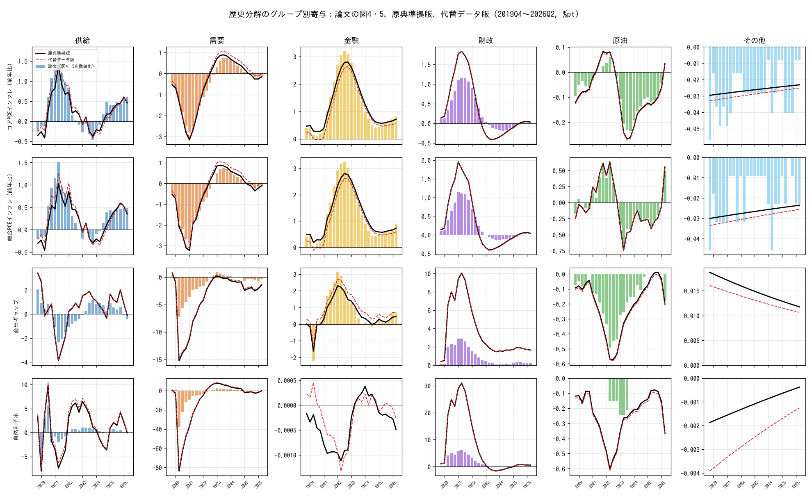

# セントルイス連銀 DSGE モデル：Python 移植

原典は Faria-e-Castro (2026) "The St. Louis Fed DSGE Model", FRB St. Louis *Review* Q4 2026（DOI: [https://doi.org/10.20955/r.2026.14](https://doi.org/10.20955/r.2026.14)）。

## ファイル
| ファイル | 内容 |
|---|---|
| `stlouis_dsge.py` | モデル本体。定常状態、線形化、QZ 解法、IRF、シミュレーション |
| `figures/irf_group1〜4.png` | 12個の構造ショックに対する IRF（GDP成長率、FF金利、コア／総合インフレ前年比）。付録Dと同じ形式 |
| `data.py` | FRED API から観測データ15系列を取得して `data/observables.csv` を作る（`FRED_API_KEY` 環境変数が必要）。`--paper-sources` で Fernald TFP と SPF の期待インフレを取得して `data/observables_paper.csv` を作る |
| `hd.py` | 観測方程式 (100)〜(114)、測定誤差、COVID特殊ショックを入れた状態空間でカルマン平滑化を行い、歴史分解を計算 |
| `figures/hd_core_pce.png` | コアPCEインフレ（前年比）の歴史分解。論文の図4(a)に対応 |
| `figures/hd_simplified.png` | コア・総合インフレ、産出ギャップ、自然利子率の歴史分解。論文の図4・図5に対応（`_alt` 付きは代替データ版） |
| `hd_compare_sources.py` | 原典準拠版・代替データ版・論文の図4・5（数値化）のグループ別寄与を比較 |
| `tools/digitize_paper_hd.py` | 論文PDFの図4・5を数値化して `data/paper_hd_digitized.csv` を作る |
| `figures/irf_gap_rstar.png` | 産出ギャップと自然利子率 r* の IRF（伸縮価格経済を同時に解いて計算） |

## 実装内容
- 付録Aの均衡条件 (47)〜(99) をトレンド除去後の形でそのまま記述した。粘着価格経済と伸縮価格経済を同時に解き、変数は全部で98個ある。
- 資本家の予算制約はワルラス法則で冗長になるため、モデルからは外した。定常状態で残差が 1e-16 になることを確認済み。
- 定常状態は解析的に解いた。正規化は n=1、pO=1 の2つで、ξ̄、ōS、消費税率 τc は内生的に決まる（τc=21.5%）。
- 線形化には複素ステップ微分を使い、機械精度のヤコビアンを得た。
- 解は `scipy.linalg.ordqz` による一般化 Schur 分解で求めた。Blanchard–Kahn 条件（安定根98 = 変数98）を満たし、行列方程式の残差は 5e-12。
- パラメータは表1の値と表C-1・C-2の事後平均。価格・賃金マークアップは ARMA(1,1)。

## 論文の付録Dとの比較（1標準偏差ショック、ピーク値の目視比較）
| ショック | GDP成長率インパクト 論文 / Python | FF金利の極値 論文 / Python | コアインフレの極値 論文 / Python |
|---|---|---|---|
| 金融政策 | 0.3 / 0.67 | 3.70 / 3.84 | 1.76 / 1.81 |
| インフレ目標 | 2.12 / 2.08 | 3.28 / 3.30 | 2.165 / 2.17 |
| 投資の限界効率 | 3.6 / 4.3 | 3.62 / 3.81 | 2.22 / 2.35 |
| 価格マークアップ | 0.85 / 0.88 | 3.33 / 3.40 | 2.17 / 2.21 |
| 賃金マークアップ | 1.3 / 1.66 | 3.38 / 3.49 | 2.22 / 2.30 |
| 原油供給 | 2.1 / 2.07 | 3.18 / 3.19 | 総合 1.84 / 1.85 |
| 限界効用（需要） | 3.2 / 3.38 | 3.45 / 3.47 | 2.17 / 2.18 |
| コンビニエンス・イールド | 1.1 / 1.17 | 2.75 / 2.69 | 1.73 / 1.73 |
| 政府消費 | 2.2 / 2.31 | 3.21 / 3.25 | 2.025 / 2.06 |
| 移転支出 | 1.70 / 1.75 | 3.18 / 3.20 | 2.012 / 2.04 |
| 労働不効用 | 2.6 / 2.14 | 3.08 / 3.00 | 1.97 / 1.95 |
| TFP成長率 | 4.0 / 2.54 | 2.87 / 2.55 | 1.78 / 1.65 |

12個中10個のショックでは、符号、形、大きさがほぼ再現できた。差が大きいのは2つの恒久トレンドショック（TFP、労働不効用）で、Python 版はインパクト時のGDPの伸びが小さく、FF金利とインフレの低下が大きい。考えられる原因は、論文に明記のない実装細部（賃金NKPCのトレンド調整、オリジナルの Dynare コードでの変数のタイミングなど）。オリジナルのコードは公開されていないため、完全一致は検証できない。

## 歴史分解（論文 4.1 節）
**論文と同じ観測情報（Fernald TFP・SPF期待インフレ）と、論文の事後平均パラメータによる歴史分解**。推定はしていない。

```
python data.py                    # FRED から15系列（FRED_API_KEY が必要）→ data/observables.csv（代替データ版）
python data.py --paper-sources    # SF連銀・フィラデルフィア連銀の原データ → data/observables_paper.csv（原典準拠版）
python hd.py                      # 原典準拠版の歴史分解（python hd.py alt で代替データ版、出力に _alt が付く）
python hd_compare_sources.py      # 2つの版と論文の図4・5（数値化）の比較
```

- 状態空間は、モデルの解に AR(1) 測定誤差7本（GDP、TFP、原油価格、ガソリン、インフレ期待、期間プレミアム、コンビニエンス・イールド）を加えたもの
- 10年金利・10年インフレ期待・コンビニエンス・イールドは、モデルの将来期待の和（Σ P^i）で表現
- COVID特殊ショックは、論文の有効期間（χ：2020Q1〜Q3、移転：2020Q2〜2022Q1、ΓN：2020Q1〜Q4）だけ分散1とする時変共分散で扱った
- Durbin-Koopman 平滑化でショックを取り出し、各ショックの寄与を積み上げた。「その他」は初期値と測定誤差

### 観測データ（論文 3.2 節）
| 系列 | 原典準拠版（`observables_paper.csv`, 既定） | 代替データ版（`observables.csv`） |
|---|---|---|
| TFP成長率 | Fernald（SF連銀 `quarterly_tfp.xlsx`）から dtfp/(1−α) − α/(1−α)·dutil を作り、1959Q1〜2026Q2 の平均（1.59）を引く。270四半期 | 全期間欠損 |
| 10年インフレ期待 | SPF の10年PCE予測（2007Q1〜）。それ以前は10年CPI予測（SPF 1991Q4〜、Livingston と Blue Chip の合成 1979Q4〜1991Q3）から、PCE10とCPI10の重なる期間の平均差 0.176 を引いて接続 | FRED `EXPINF10YR`（クリーブランド連銀）− CPIとPCEの実績インフレの平均差 |

ほかの13系列は両版で同じ。原典準拠版の期待インフレは代替版より平均0.45%pt高く、特に2010年代（2015年: 1.94 対 1.22）の差が大きい。
未再現の点: Livingston と Blue Chip の合成方法は、フィラデルフィア連銀の合成済み系列（`Additional-CPIE10.xlsx` の Combined）を
そのまま使った。論文がどの版（ヴィンテージ）の Fernald 系列を使ったかは分からない（ここでは2026年11月6日版）。
PCEとCPIの「平均差」をどの期間で取ったかは論文に明記がなく、ここでは SPF の PCE10 と CPI10 が重なる 2007Q1 以降とした。
`cobs` 定数は「各系列の平均成長率 − GDP成長率の平均」で置いた（両版共通）。

### 論文の図4・5との比較
論文の図4・5（2019Q4〜2026Q2 の積み上げ棒）を `tools/digitize_paper_hd.py` で数値化し（`data/paper_hd_digitized.csv`）、
グループ別の寄与を時点ごとに比べた。指標は `data/hd_compare_groups.csv`、期間平均は `data/hd_compare_periods.csv`、
ショック別の感度は `data/hd_sensitivity_shocks.csv`。



コアPCE（前年比, 定常状態からの乖離, %pt）

| 時点 | 版 | 供給 | 需要 | 金融 | 財政 | 原油 |
|---|---|---|---|---|---|---|
| 2022Q1 | 論文（図4a） | 0.84 | −1.10 | 2.68 | 0.89 | 0.04 |
| | 原典準拠版 | 0.72 | −0.79 | 2.22 | 1.15 | 0.08 |
| | 代替データ版 | 0.90 | −0.70 | 1.95 | 1.15 | 0.07 |
| 2023Q1 | 論文（図4a） | −0.28 | 0.31 | 2.77 | 0.04 | −0.11 |
| | 原典準拠版 | −0.07 | 0.72 | 2.61 | −0.30 | −0.13 |
| | 代替データ版 | −0.08 | 0.87 | 2.47 | −0.30 | −0.14 |
| 2026Q1 | 論文（図4a） | 0.58 | −0.19 | 0.72 | 0.00 | −0.04 |
| | 原典準拠版 | 0.60 | −0.26 | 0.66 | 0.05 | −0.06 |
| | 代替データ版 | 0.60 | −0.11 | 0.52 | 0.04 | −0.07 |

- **インフレ（図4）**: どちらの版も、グループ別寄与の符号・時期は論文とよく合う（相関0.86〜0.99、符号一致率94〜100%）。
  原典準拠版にすると、2019Q4以降の27四半期でのグループ別の平均絶対誤差がコアPCEで0.151→0.128、総合PCEで0.161→0.141に下がる。
  主に金融（0.27→0.19）と需要（0.25→0.16）が論文に近づいた。ショック別では、期待インフレが高めになったことでインフレ目標ショックの
  寄与が増えた（2019Q4以降の平均 +0.48→+0.79）。供給はやや離れた（0.14→0.18）
- **産出ギャップ・自然利子率（図5）**: 観測データの違いはほとんど効かない。ただし**どちらの版も2020〜21年の需要と財政の寄与が論文の
  3〜5倍**ある（産出ギャップの財政: 論文 +2.1 対 Python +7.3、自然利子率の需要: 論文 −12 対 Python −35）。
  観測データでは説明できないモデル側の差で、原因は特定できていない（産出ギャップと r* を計算する伸縮価格経済の扱いや、
  COVIDショックの大きさが候補だが、仮説）
- 図から読んだ値の誤差: 1ピクセルはコアPCEで0.008%pt、自然利子率で0.06%pt。棒の枠線の割り振りを含めて±2〜3ピクセル程度。
  自然利子率の2020Q2の棒は軸の外にはみ出しているので、比較から外した
- コアインフレの観測式には測定誤差がないので、平滑化した合計が実績に一致するのは当然で、グループ別寄与の正しさの独立した検証ではない。
  上の比較はそのために合計ではなくグループ別の寄与で行った

## 日本版（お試し）
米国のパラメータのまま日本データで歴史分解した試算を `jp/` に置いた。詳細は [jp/README.md](jp/README.md)。

## 未実装
- ベイズ推定（事後モード、MCMC）
- 条件付き予測

## 解説記事
- note 下書き（ウェブ版）：[https://p72.github.io/note-draft/セントルイス連銀のDSGEモデル/01_セントルイス連銀のDSGEモデルをPythonで動かした.html](https://p72.github.io/note-draft/%E3%82%BB%E3%83%B3%E3%83%88%E3%83%AB%E3%82%A4%E3%82%B9%E9%80%A3%E9%8A%80%E3%81%AEDSGE%E3%83%A2%E3%83%87%E3%83%AB/01_%E3%82%BB%E3%83%B3%E3%83%88%E3%83%AB%E3%82%A4%E3%82%B9%E9%80%A3%E9%8A%80%E3%81%AEDSGE%E3%83%A2%E3%83%87%E3%83%AB%E3%82%92Python%E3%81%A7%E5%8B%95%E3%81%8B%E3%81%97%E3%81%9F.html)
