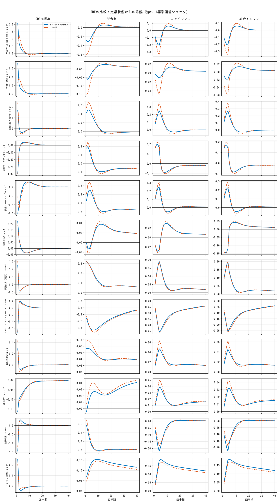

# セントルイス連銀 DSGE モデル：Python 移植

原典は Faria-e-Castro (2026) "The St. Louis Fed DSGE Model", FRB St. Louis *Review* Q4 2026（DOI: [https://doi.org/10.20955/r.2026.14](https://doi.org/10.20955/r.2026.14)）。

## ファイル
| ファイル | 内容 |
|---|---|
| `stlouis_dsge.py` | モデル本体。定常状態、線形化、QZ 解法、IRF、シミュレーション |
| `figures/irf_group1〜4.png` | 12個の構造ショックに対する IRF（GDP成長率、FF金利、コア／総合インフレ前年比）。付録Dと同じ形式 |
| `data.py` | FRED API から観測データ15系列を取得して `data/observables.csv` を作る（`FRED_API_KEY` 環境変数が必要） |
| `hd.py` | 観測方程式 (100)〜(114)、測定誤差、COVID特殊ショックを入れた状態空間でカルマン平滑化を行い、歴史分解を計算 |
| `figures/hd_core_pce.png` | コアPCEインフレ（前年比）の歴史分解。論文の図4(a)に対応 |
| `figures/hd_simplified.png` | コア・総合インフレ、産出ギャップ、自然利子率の歴史分解。論文の図4・図5に対応 |
| `figures/irf_gap_rstar.png` | 産出ギャップと自然利子率 r* の IRF（伸縮価格経済を同時に解いて計算） |
| `irf_compare.py` | 論文の付録DのIRF（数値化）と Python 版を定常状態からの乖離で比較。`data/irf_comparison.csv`、`figures/irf_compare_deviation.png` |
| `tools/digitize_paper_irf.py` | 論文PDFの付録Dの図を数値化して `data/paper_irf_digitized.csv` を作る（pdfimages, tesseract が必要） |

## 実装内容
- 付録Aの均衡条件 (47)〜(99) をトレンド除去後の形でそのまま記述した。粘着価格経済と伸縮価格経済を同時に解き、変数は全部で98個ある。
- 資本家の予算制約はワルラス法則で冗長になるため、モデルからは外した。定常状態で残差が 1e-16 になることを確認済み。
- 定常状態は解析的に解いた。正規化は n=1、pO=1 の2つで、ξ̄、ōS、消費税率 τc は内生的に決まる（τc=21.5%）。
- 線形化には複素ステップ微分を使い、機械精度のヤコビアンを得た。
- 解は `scipy.linalg.ordqz` による一般化 Schur 分解で求めた。Blanchard–Kahn 条件（安定根98 = 変数98）を満たし、行列方程式の残差は 5e-12。
- パラメータは表1の値と表C-1・C-2の事後平均。価格・賃金マークアップは ARMA(1,1)。

## 論文の付録Dとの比較（定常状態からの乖離による定量比較）
`python irf_compare.py` で再現できる。論文の付録D（図D-1〜D-12）は画像なので、`tools/digitize_paper_irf.py` で
青い線と定常状態の破線を数値化し（`data/paper_irf_digitized.csv`）、Python版と**それぞれのモデルの定常状態からの乖離**で比べた。
指標の一覧は `data/irf_comparison.csv`、全48パネルの重ね描きは下の図。

そろえた条件
- ショックの大きさ: どちらも1標準偏差。Python版は表C-2の事後平均の標準偏差
- 単位: すべて %pt（GDP成長率・FF金利は年率、インフレは前年比）。論文の縦軸「pp」と同じ
- 期間とタイミング: 1〜40四半期。h=1 をショックの当期とした（論文の横軸は1から始まり、ほぼ全ショックで h=1 に初期反応が出ている）
- 乖離: 論文は図中の破線、Python版は `Model.ss` からの差。破線の値は論文が GDP 1.875、FF金利 3.1405、インフレ 1.980、
  Python版が 1.875、3.151、1.995 で、**インフレとFF金利の定常値が0.01〜0.015ずれている**（原因は未確認）。旧版の水準比較では
  このずれが反応幅に混ざっていた

| ショック | GDP成長率 初期 論文 / Python | FF金利 ピーク 論文 / Python | コアインフレ ピーク（時点） 論文 / Python | 相対RMSE（4変数） | 判定 |
|---|---|---|---|---|---|
| 生産性（TFP成長率） | +2.07 / +0.67 | −0.32 / −0.60 | −0.21（4期） / −0.34（4期） | 0.12〜0.25 | 大きさに差 |
| 労働不効用 | +0.72 / +0.27 | −0.063 / −0.15 | +0.013（13期） / +0.022（12期） | 0.12〜0.83 | 差が大きい |
| 投資の限界効率 | +1.68 / +2.40 | +0.49 / +0.66 | +0.25（4期） / +0.36（4期） | 0.07〜0.13 | 大きさに差 |
| 価格マークアップ | −0.98 / −0.99 | +0.20 / +0.25 | +0.19（3期） / +0.22（3期） | 0.01〜0.09 | ほぼ近い |
| 賃金マークアップ | −0.60 / −0.22 | +0.25 / +0.34 | +0.25（4期） / +0.31（4期） | 0.07〜0.13 | 大きさに差 |
| 原油供給 | +0.22 / +0.19 | +0.037 / +0.043 | −0.029（3期） / −0.032（3期） | 0.02〜0.09 | 近い |
| 限界効用（需要） | +1.24 / +1.51 | +0.32 / +0.32 | +0.19（4期） / +0.19（4期） | 0.02〜0.04 | 近い |
| コンビニエンス・イールド | −0.72 / −0.70 | −0.43 / −0.47 | −0.25（4期） / −0.26（4期） | 0.02〜0.04 | 近い |
| 政府消費 | +0.29 / +0.43 | +0.072 / +0.098 | +0.047（4期） / +0.064（4期） | 0.09〜0.12 | 大きさに差 |
| 移転支出 | −0.16 / −0.12 | +0.041 / +0.044 | +0.038（4期） / +0.050（4期） | 0.05〜0.18 | 大きさに差 |
| 金融政策 | −1.45 / −1.21 | +0.56 / +0.69 | −0.22（4期） / −0.18（4期） | 0.04〜0.06 | 近い |
| インフレ目標 | +0.25 / +0.21 | +0.15 / +0.15 | +0.19（5期） / +0.17（5期） | 0.04〜0.08 | 近い |

- 値は定常状態からの乖離（%pt）。ピークは論文側の絶対値最大の時点と、Python側の同じ向きの極値。累積反応・相関は CSV にある
- 相対RMSE = 40期の経路の二乗平均誤差 ÷ 論文の反応の最大絶対値
- 判定（変数ごと、目安）: 「近い」はピーク比 0.8〜1.25 かつ相対RMSE ≤ 0.25、「大きさに差」はピーク比 0.5〜2 かつ相対RMSE ≤ 0.5
  （形は同じで大きさが違う）、それ以外は「差が大きい」。表の判定は4変数をまとめたもの（全部「近い」→近い、1つだけ外れ→ほぼ近い）
- 読取り誤差: 目盛りの当てはめ誤差は最大0.002%pt程度。線の中心の読取りは1ピクセル相当の値（`data/paper_irf_digitized_meta.csv`
  の `val_per_px`）の±2倍を目安とし、パネルにより0.0001〜0.01%pt。破線が値域の外にあるパネルは他パネルの中央値を使った

**再現できている範囲**: 12ショック中、4変数とも経路が近いのは**5つ**（原油供給、限界効用、コンビニエンス・イールド、金融政策、
インフレ目標）、ほぼ近いのが価格マークアップ。投資の限界効率・政府消費・移転支出・賃金マークアップは、符号・形・ピーク時点は
合うが、Python版の反応が**3〜5割大きい**。TFP成長率と労働不効用の2つの恒久トレンドショックは、GDP成長率の初期反応が論文の
3分の1程度で、FF金利とインフレの反応は1.6〜4倍。旧版の「12個中10個がほぼ再現」は水準の目視比較による過大評価だったので撤回する。

**未確認のこと（原因は特定できていない）**
- 論文には、付録Dの図をどのパラメータ（事後平均・モード・事後分布の中央値など）で描いたか、ショックの大きさ・正規化の説明がない。
  Python版は表C-1・C-2の事後平均を使っている。インフレとFF金利の定常値のずれは、図のパラメータか年率換算が違う可能性を示すが確認できない
- トレンドショックの差について、賃金NKPCのトレンド調整や Dynare コードでの変数のタイミングが原因という説明は**仮説**。
  オリジナルのコードは公開されておらず検証できない。図に合わせるためだけに式を変えることはしていない
- 付録Aの均衡条件との対応と解の数値的整合性（行列方程式の残差 5e-12）は確認済みだが、これは実装した式が正しく解けていることの
  確認であって、論文のIRFとの一致を保証するものではない

## 歴史分解（論文 4.1 節）
`python data.py && python hd.py` で再現できる。パラメータは事後平均のままで、推定はしていない。

- 状態空間は、モデルの解に AR(1) 測定誤差7本（GDP、TFP、原油価格、ガソリン、インフレ期待、期間プレミアム、コンビニエンス・イールド）を加えたもの
- 10年金利・10年インフレ期待・コンビニエンス・イールドは、モデルの将来期待の和（Σ P^i）で表現
- COVID特殊ショックは、論文の有効期間（χ：2020Q1〜Q3、移転：2020Q2〜2022Q1、ΓN：2020Q1〜Q4）だけ分散1とする時変共分散で扱った
- Durbin-Koopman 平滑化でショックを取り出し、各ショックの寄与を積み上げた。「その他」は初期値と測定誤差

コアPCEの分解は論文の図4(a)とよく合う。2020〜21年は需要（マイナス）と財政（プラス）、2022〜23年は金融、2025〜26年は供給と金融が主な寄与になっている。

| 時点 | 供給 | 需要 | 金融 | 財政 | 原油 | 合計 |
|---|---|---|---|---|---|---|
| 2022Q1 | 0.90 | −0.70 | 1.95 | 1.15 | 0.07 | 3.34 |
| 2023Q1 | −0.08 | 0.87 | 2.47 | −0.30 | −0.14 | 2.80 |
| 2026Q1 | 0.60 | −0.11 | 0.52 | 0.04 | −0.07 | 0.96 |

論文との違い：
- Fernald の TFP（SF連銀）と SPF のインフレ期待（フィラデルフィア連銀）は取得できなかった。TFP は欠損扱いにし、インフレ期待は FRED の `EXPINF10YR`（クリーブランド連銀、CPIベース）から CPI と PCE の平均差を引いて代用した
- `cobs` 定数は「各系列の平均成長率 − GDP成長率の平均」で置いた
- 自然利子率（スポット）は、COVID需要ショックを受けて2020年に大きく振れる

## 日本版（お試し）
米国のパラメータのまま日本データで歴史分解した試算を `jp/` に置いた。詳細は [jp/README.md](jp/README.md)。

## 未実装
- ベイズ推定（事後モード、MCMC）
- 条件付き予測

## 解説記事
- note 下書き（ウェブ版）：[https://p72.github.io/note-draft/セントルイス連銀のDSGEモデル/01_セントルイス連銀のDSGEモデルをPythonで動かした.html](https://p72.github.io/note-draft/%E3%82%BB%E3%83%B3%E3%83%88%E3%83%AB%E3%82%A4%E3%82%B9%E9%80%A3%E9%8A%80%E3%81%AEDSGE%E3%83%A2%E3%83%87%E3%83%AB/01_%E3%82%BB%E3%83%B3%E3%83%88%E3%83%AB%E3%82%A4%E3%82%B9%E9%80%A3%E9%8A%80%E3%81%AEDSGE%E3%83%A2%E3%83%87%E3%83%AB%E3%82%92Python%E3%81%A7%E5%8B%95%E3%81%8B%E3%81%97%E3%81%9F.html)
