# 日本版 歴史分解（お試し版と本格版）

米国で推定されたセントルイス連銀DSGEの事後平均パラメータを**そのまま**使い、日本の観測データをカルマン平滑化にかけて
構造ショックを取り出し、コアCPIなどを歴史分解したもの。パラメータは日本で推定し直していないので、結果は「形を見るための試算」。

## 図

### コアCPI（生鮮食品及びエネルギーを除く総合、前年比）の歴史分解 1995〜2026Q3
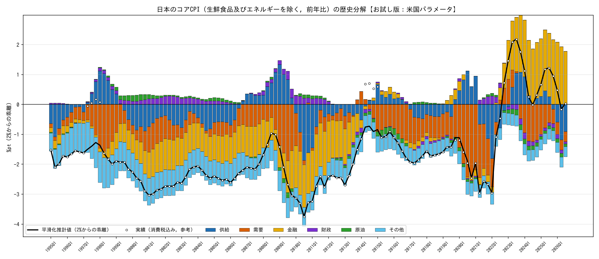

### 2019Q4以降：コアCPI・GDP成長率・産出ギャップ・自然利子率
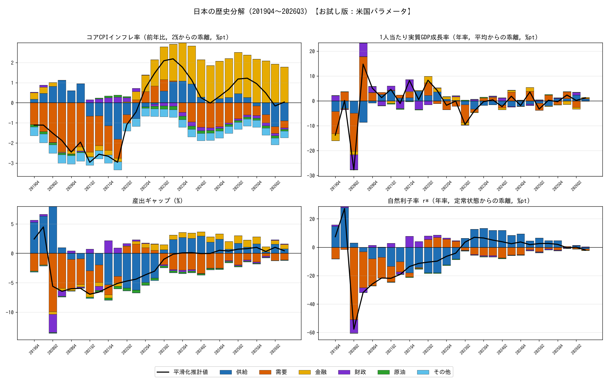

### 政策金利：モデルの推計値（ゼロ金利期は影の金利）とコールレート
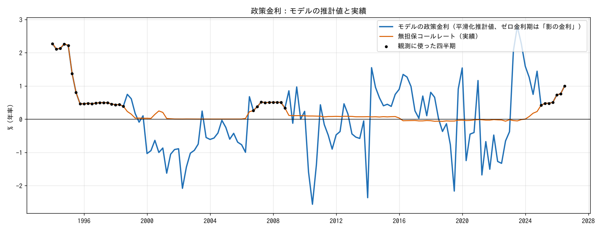

## ファイル
| ファイル | 内容 |
|---|---|
| `data_jp.py` | ESRI・e-Stat・FRED から観測データを取得して `data/observables_jp.csv` を作る |
| `hd_jp.py` | カルマン平滑化と歴史分解。親フォルダの `stlouis_dsge.py`・`hd.py` を再利用 |
| `figures/hd_jp_core_cpi.png` | コアCPI（生鮮食品及びエネルギーを除く総合、前年比）の歴史分解 1995〜2026Q3 |
| `figures/hd_jp_since2019.png` | 2019Q4以降のコアCPI・GDP成長率・産出ギャップ・自然利子率の分解 |
| `figures/hd_jp_shadow_rate.png` | モデルが推計した政策金利（ゼロ金利期は影の金利）とコールレート |

```
FRED_API_KEY=xxxx ESTAT_APP_ID=yyyy python jp/data_jp.py
python jp/hd_jp.py
```

## 観測データ（1994Q1〜2026Q3）
| モデルの観測 | 日本で使った系列 | 出典 |
|---|---|---|
| 1人当たり実質GDP・消費・投資・政府消費の成長率 | 名目季調（GDP、民間最終消費、民間住宅＋民間企業設備、政府最終消費）÷GDPデフレーター÷人口 | ESRI QE（2026年7-9月期1次速報） |
| 実質賃金の伸び | 雇用者報酬（名目季調）÷GDPデフレーター÷就業者数 | ESRI QE、FRED `LFEMTTTTJPQ647S` |
| 労働時間 | 就業者数÷人口（1人当たり労働時間は入れていない） | FRED |
| 政策金利 | 無担保コールレート。**0.25%以下の四半期は欠損** | FRED `IRSTCI01JPM156N` |
| コアインフレ | CPI 生鮮食品及びエネルギーを除く総合（2010年〜は公式季調値、それ以前は原系列を簡易季調して接続） | e-Stat `0003427113` |
| ガソリン価格 | CPI ガソリン（簡易季調） | e-Stat |
| 原油価格 | WTI×円ドル÷GDPデフレーター（対数・平均除去） | FRED |
| 移転支出・TFP・10年インフレ期待・10年金利・CY | 使わない（全期間欠損） | — |

人口は世界銀行の年次総人口（FRED `POPTOTJPA647NWDB`）を四半期に補間し、HPトレンドで均した。

## 日本向けの工夫
- **ゼロ金利・マイナス金利**: モデルは線形でゼロ金利制約を持たない。コールレートが0.25%以下の期間は観測から外し、
  政策金利はモデルの中で自由に動く「影の金利」にした。
- **消費税率引き上げ**（1997Q2・2014Q2・2019Q4）: その四半期のコアCPIとガソリンの前期比を欠損にした。
  分解図の黒線は税の影響を除いた値、白丸は税込みの実績（参考）。
- **トレンド成長率の違い**: 実質成長率・賃金・労働時間・ガソリンの観測方程式の定数を日本のサンプル平均にした。
  モデルのトレンドは米国のままなので、日本の低成長を恒常的なショックと誤認しないための調整。
- **インフレの定常状態は2%のまま**: 日銀の物価安定の目標と同じ。図は「2%からの乖離」で、政策金利の定常状態は3.15%。

## 結果の読み方（お試し版）
- 1995〜2012年のコアCPIは2%を2〜3%pt下回り続けた。モデルはこれを主に**金融（インフレ目標ショック＝トレンド
  インフレの低下）**と**需要**で説明し、2009〜10年の落ち込みは需要・TFP（供給）も大きい。
- 2021〜22年の大きなマイナスは供給（TFP）と需要。携帯電話通信料の値下げ（2021年4月）は、このモデルでは供給側として現れる。
- 2023年以降のプラスは、**金融（インフレ目標ショック＋1.1〜1.2%pt、金融政策ショック＋0.6〜0.9%pt）**が中心。
  トレンドインフレが上がったうえに、政策金利がルールより低く据え置かれた（緩和的だった）という解釈になる。
- 影の金利は四半期ごとの振れが大きい。米国推定の金融政策ショックは持続性が低い（ρ=0.07）ため。

## 限界
- パラメータは米国の推定値。価格・賃金の硬直性、テイラー則の係数、ショックの大きさは日本と違う可能性が高い。
- 閉鎖経済モデルで為替・輸入物価の経路がない。2022〜23年の円安・輸入物価上昇は、供給や金融など別のショックに割り振られる。
- ゼロ金利は「観測を外す」だけの簡易対応。時変パラメータやOccBin等による本格的な扱いではない。
- 1人当たり労働時間、移転支出、インフレ期待、長期金利を観測に入れていないので、識別は米国版より弱い。
- 期首の初期値の影響（図の「その他」）が数年残る。

## お試し版の時点での所見：本格版に進むべきか
進める価値は高い。お試し版でも「長期の低インフレ＝トレンドインフレ（期待）の低さ」「2023年以降の上昇＝トレンドインフレの
上昇と緩和的な金利」という、日本の議論と整合的な形が出た。一方で、金融ショックの振れの大きさや影の金利のノイズは、
米国パラメータが日本に合っていないことを示している。本格版では次の順で進めるのがよい。
1. 日本データでの事後モード推定（硬直性、テイラー則、ショックの持続性と大きさ）
2. ゼロ金利の扱いの改善（影の金利を観測に使う、またはゼロ金利期の期待金利経路を制約する）
3. 為替・輸入物価を入れた開放経済化、またはエネルギー以外の輸入物価ショックの追加
4. 日銀短観の物価見通し・10年国債利回り（YCC期間は除く）を観測に追加

---

# 本格版：日本データでのベイズ推定

お試し版と同じ観測データ（10系列, 1994Q2〜2026Q3）で、パラメータ37個をベイズ推定し、歴史分解を作り直した。

```
python jp/estimate_jp.py mode          # 事後モード（L-BFGS-B、止まったら再起動。途中経過は estimation/mode_progress.json）
python jp/estimate_jp.py hessian       # モードでのヘッセ行列
python jp/estimate_jp.py mcmc 15000 4  # ランダムウォーク・メトロポリス 4チェーン（500回ごとに保存、再実行で続きから）
python jp/estimate_jp.py summary       # estimation/posterior_summary.csv
python jp/hd_jp_est.py                 # 本格版の歴史分解と比較図（既定は事後平均。`python jp/hd_jp_est.py mode` でモード）
```

**クリーンチェックアウトでの再生成**: MCMCチェーン本体（`estimation/chain*.npz`）はGit管理外。`hd_jp_est.py` の事後平均は
チェーン → `estimation/posterior_mean.csv`（`summary` が全精度で書く）→ 公開している `estimation/posterior_draws_thin10.csv`
（4,200ドロー）の平均、の順で探し、どれも無ければ止まる（モードには切り替えない）。使ったパラメータの出どころは標準出力と
`data/historical_decomposition_jp_est.source.txt` に書く。掲載の歴史分解CSV・図は全チェーン（42,000ドロー）の平均で作ったもので、
間引きドローの平均で再生成すると差は最大0.003%pt程度（2023年以降の金融寄与はどちらも +1.22%pt）。
`posterior_summary.csv` の事後平均は小数4桁に丸めてあり、小さい標準偏差（sig_mp など）がずれるので再生成には使わないこと。

## 推定の設定
- **推定するもの（37個）**: 価格・賃金の調整コスト（etap, etaw）、指数化（iotap, iotaw）、投資調整コスト、稼働率、
  労働供給の弾力性、テイラー則（phiPi, phiY, rhor）、10個のショックの持続性と標準偏差、マークアップのMA項、
  COVIDショック2個の大きさ、測定誤差3個（GDP・ガソリン・原油）。
- **固定するもの**: 定常状態を決めるパラメータ（トレンド成長率、割引率、インフレ目標2%、財政比率など）と、観測しない
  移転支出・コンビニエンス・イールドのショック過程は米国の値のまま。
- **事前分布**: 米国の事後平均を中心に置いた（米国の推定値を出発点に日本のデータで更新する考え方）。
  0〜1のパラメータはベータ分布（標準偏差0.1〜0.15）、正のパラメータはガンマ分布（標準偏差は平均の30〜40%）、
  ショックの標準偏差は対数正規（対数の標準偏差1）。
- **アルゴリズム**: カルマンフィルターで尤度を計算（数値安定のため共分散を毎期対称化し、コレスキー分解で解く）。
  事後モードのヘッセ行列を提案分布にしたランダムウォーク・メトロポリスを4チェーン×15,000回（採択率0.33〜0.34）。
  最初の30%を捨てて42,000ドロー。Gelman-Rubin の R-hat は全パラメータで1.06未満（37個中34個は1.02未満）。

## 推定結果（米国との違いが大きいもの）
| パラメータ | 意味 | 米国 | 日本（事後平均, 90%区間） |
|---|---|---|---|
| etap | 価格の調整コスト | 77.9 | **17.6**（13.0〜23.5） |
| iotap | 価格の過去インフレへの指数化 | 0.26 | **0.07**（0.02〜0.16） |
| iotaw | 賃金の指数化 | 0.76 | **0.33**（0.14〜0.60） |
| rhor | 政策金利の慣性 | 0.81 | **0.96**（0.95〜0.98） |
| sig_mp | 金融政策ショックの大きさ | 0.0024 | **0.0005**（0.0004〜0.0007） |
| sig_mup | 価格マークアップショックの大きさ | 0.029 | **0.010**（0.009〜0.012） |
| psii | 投資の調整コスト | 1.95 | 2.86（2.00〜3.94） |
| phiPi, phiY | テイラー則のインフレ・GDP反応 | 2.85, 0.76 | 2.71, 0.71（ほぼ事前分布のまま） |

全パラメータの表は [estimation/posterior_summary.csv](estimation/posterior_summary.csv)。


読み方
- 日本の価格は米国より**調整コストが小さく、過去のインフレにほとんど連動しない**。コアCPIは前期の値に引きずられにくく、
  その時々のショックに素直に反応する形になった。賃金の指数化も米国の半分以下。
- 金融政策は**金利の慣性が非常に強く（0.96）、予想外の金利変更（金融政策ショック）は米国の5分の1**。
  長いゼロ金利と小刻みな利上げという日本の経験と合っている。
- テイラー則の反応係数は事前分布からほとんど動いていない。ゼロ金利期の金利を観測から外しているので、データに情報が少ない。

## 本格版の歴史分解


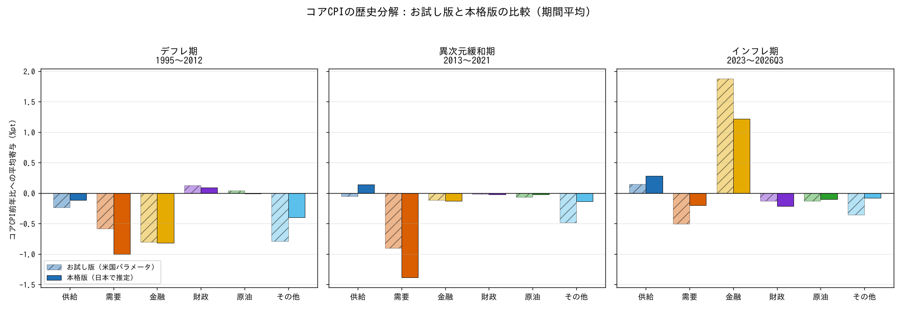

| 期間 | お試し版（米国パラメータ） | 本格版（日本で推定） |
|---|---|---|
| 1995〜2012年（平均 −2.3%pt） | 金融 −0.80、その他 −0.79、需要 −0.58 | **需要 −1.00、金融 −0.81**、その他 −0.40 |
| 2013〜2021年（平均 −1.6%pt） | 需要 −0.90、その他 −0.49 | **需要 −1.38** |
| 2023〜2026Q3（平均 +0.9%pt） | **金融 +1.88**、需要 −0.51 | **金融 +1.22**、供給 +0.28、需要 −0.20 |

- **デフレ期**: 「需要不足」と「金融（トレンドインフレの低さと引き締め気味の金利）」が半々。お試し版より需要の比重が上がり、
  初期値の影響（その他）が半分になった。
- **異次元緩和期**: 2%に届かなかった理由はほぼ「需要」。金融の寄与はほぼゼロで、緩和をしてもインフレが上がらなかった
  原因をモデルは需要側の弱さに求めている。
- **2023年以降**: 「金融」が主役なのは変わらないが、+1.9→+1.2%ptに縮んだ。2023年のピークには供給（TFP）の寄与も大きい。
  なお需要グループの中の「コンビニエンス・イールド」ショック（パラメータ固定・観測なし）が2024年以降に+1%pt前後出ており、
  これは他で説明しきれない部分を拾っている可能性がある。

### 2019Q4以降：コアCPI・GDP成長率・産出ギャップ・自然利子率（本格版）
お試し版の [hd_jp_since2019.png](figures/hd_jp_since2019.png) と同じ形。

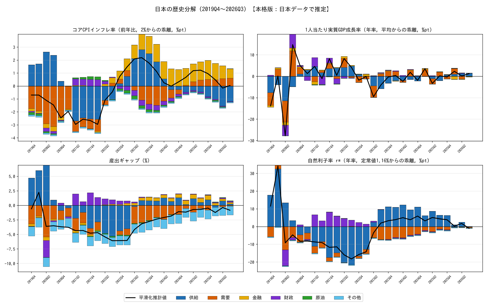

- **コアCPI**: 2020年の上振れは供給、2021〜22年の落ち込みは供給（携帯料金の値下げなど）と需要。2023年のピークは
  供給と金融、2024年以降は金融が+1〜1.5%ptで支えている。
- **産出ギャップ**: 2022年末の−6%から2026年には−1%前後まで縮小。お試し版では2023年以降プラスだったが、本格版では
  マイナス圏のまま。ただし「その他」（期首の初期値の影響）が−1.5%ほど残っている点に注意。持続性がほぼ1のショック
  （政府消費・価格マークアップ・原油）があるため、初期値の影響がなかなか消えない。
- **自然利子率 r***: コロナ期に大きく振れた後、2023〜25年は供給（TFP）の押し上げでプラス、2026年にはほぼ定常状態に戻った。
  四半期ごとの r* は振れが大きいので、方向感を見る程度にとどめたい。

### 自然利子率 r* の読み方（水準版）
上の4パネル図の r* は「**定常値からの乖離**」。定常値とは、ショックが何も起きていない長期の平均的な状態での値で、
このモデルでは **年率1.16%**（トレンド成長率・割引率など米国の設定から決まる）。水準は「1.16%＋乖離」で読む。

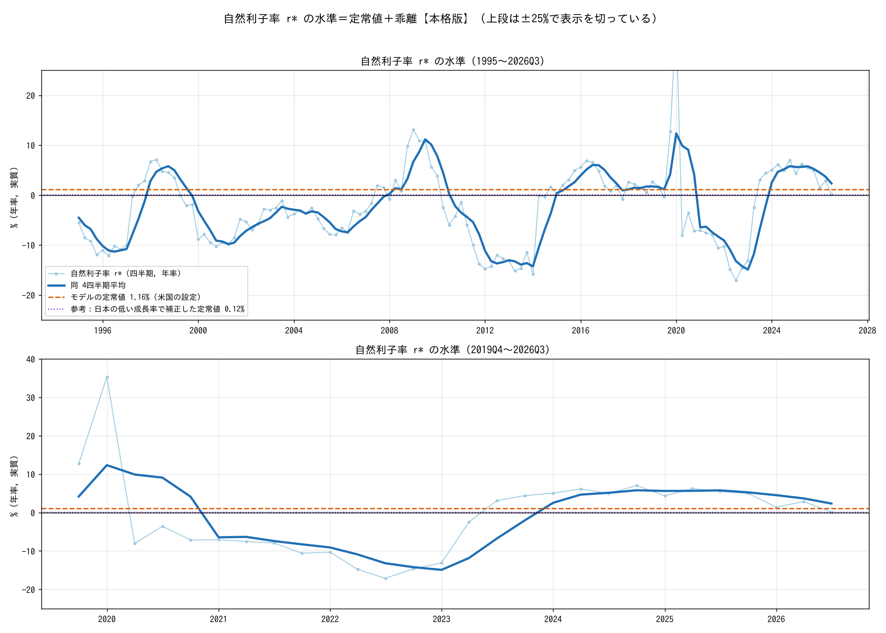

- このモデルの r* は「価格がすぐ動く仮想経済で、次の四半期に成り立つ実質金利」。景気の短期的な強さで大きく動くので、
  ±10%を超える振れも出る。日銀や Laubach-Williams 型の「中長期の自然利子率（0%前後）」とは別物で、
  四半期の値ではなく太線（4四半期平均）で方向感を見るのがよい。
- 定常値1.16%は米国のトレンド成長率（1人当たり年1.9%）を前提にしている。日本の平均成長率（年0.8%）はそれより1.0%pt
  低いので、その分を差し引いた **0.12%**（点線）を日本の目安として併記した（成長率と自然利子率が1対1で動くと仮定した粗い補正）。
- 水準で見ると、2012〜13年と2021〜22年は−10%を超える大幅なマイナス（実際の金利をゼロにしても引き締め的）、
  2024〜25年は+5%前後のプラス（低い金利は強い緩和）。2026年は+2%程度まで下がってきている。
- 数値は [data/rstar_level_jp_est.csv](data/rstar_level_jp_est.csv)。


- **影の金利が落ち着いた**: お試し版では四半期ごとに±2%も振れていたが、本格版では滑らかになり、
  2000年代前半は0〜−0.3%、2010〜2013年と2020〜22年は−1%前後と、量的緩和期に「実質的にマイナス金利だった」形になった。

## 本格版の限界と次の一歩
- 事前分布を米国の値の周りに置いているので、データの情報が少ないパラメータ（テイラー則など）は米国の値に近いまま。
- 持続性の事前分布で平均が0や1に近いもの（rho_mp, rho_chi など）は、ベータ分布が端に張り付く形になっている。
- 開放経済の要素（為替・輸入物価）、10年国債利回りや短観の物価見通しの観測はまだ入れていない（お試し版の README の手順3・4）。
- ゼロ金利は「観測から外す」だけの扱いのまま。

---

# 日本版インパルス応答（IRF）と米国との比較

IRF（インパルス応答）は「ショックが1回だけ起きたら、その後の経済がどう動くか」をモデルとパラメータだけで計算したもの。
観測データは使わないので、米国パラメータのままでは米国版と同じになる。ここでは本格版で推定した**日本の事後平均パラメータ**で
12ショックのIRFを描き、米国版（論文の事後平均）と重ねた。

```
python jp/irf_jp.py            # 事後平均（hd_jp_est.py と同じ探し方。クリーンチェックアウトでは間引きドロー4,200個の平均）
python jp/irf_jp.py mode       # 事後モード
```

- ショックの大きさは日米それぞれの**1標準偏差**。インフレの定常状態は日米とも2%、政策金利（日本はコールレート、米国はFF金利）の
  定常状態は3.15%（推定で固定したパラメータで決まるので共通）。
- 移転支出とコンビニエンス・イールドのショック過程は米国の値のまま固定しているが、価格の硬直性などが違うので応答の形は変わる。
- 衝撃時・ピーク・半減期の数値は [data/irf_jp_us_summary.csv](data/irf_jp_us_summary.csv)。

## 図（青の実線=米国、赤の破線=日本、点線=定常状態）


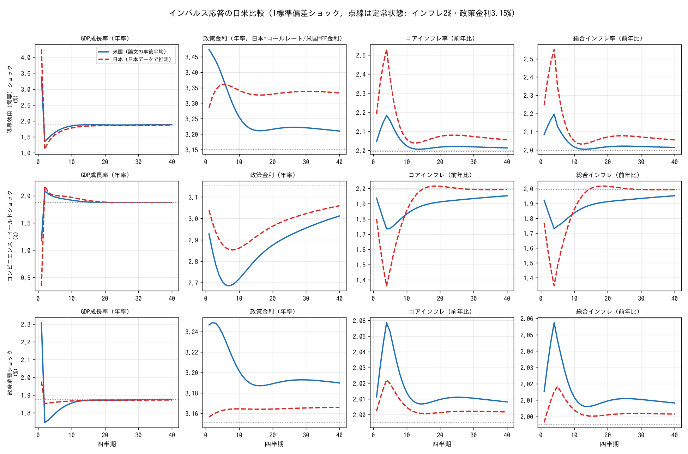


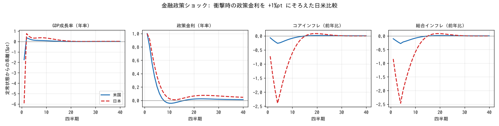

## 日米で大きく違うところ
| ショック | 米国 | 日本 | 理由（推定パラメータ） |
|---|---|---|---|
| 金融政策（1標準偏差） | 政策金利 +0.69%pt、コアインフレ最大 −0.18%pt、GDP成長率 −1.2%pt | 政策金利 **+0.15%pt**、コアインフレ最大 **−0.36%pt**、GDP成長率 −0.9%pt | 予想外の金利変更が米国の5分の1（sig_mp） |
| 金融政策（政策金利 +1%pt にそろえる） | コアインフレ最大 −0.26%pt、産出ギャップ最大 −0.44% | コアインフレ最大 **−2.4%pt**、産出ギャップ最大 **−1.5%** | 価格の調整コストが米国の4分の1（etap 78→18）で物価がすぐ動く。過去のインフレへの指数化もほぼゼロ（iotap 0.26→0.07）。金利の慣性が強く（rhor 0.81→0.96）利上げが長く続く |
| インフレ目標（トレンドインフレ） | ピーク +0.17%pt、10年後も +0.10%pt 残る | ピーク **+0.27%pt**、半減期 **6四半期**で消える | 持続性が低い（rho_pistar 0.990→0.944）。日本の「期待インフレの上振れ」は定着しにくい |
| 需要（限界効用） | コアインフレ最大 +0.19%pt | コアインフレ最大 **+0.53%pt**、政策金利は10年後も高止まり | ショックが大きく（sig_chi 0.022→0.056）持続的（rho_chi 0.94→0.98）、価格も動きやすい |
| 投資の限界効率 | GDP成長率 +2.4%pt、政策金利 +0.66%pt | GDP成長率 +0.9%pt、政策金利 +0.05%pt | ショックが半分（sig_zeta 0.070→0.036）、投資の調整コストが大きい（psii 1.95→2.86） |
| 政府消費 | GDP成長率 +0.43%pt | GDP成長率 +0.10%pt | 持続性がほぼ1（rho_g 0.9997）で、1回の衝撃は小さく長く続く形 |
| 価格マークアップ | 政策金利・インフレが数四半期で戻る | ショックが3分の1（sig_mup 0.029→0.010）で、総合インフレは2年弱でマイナスに振れる | 持続性がほぼ1（rho_mup 0.999）と価格の柔軟さ |
| TFP（生産性） | GDP成長率 ピーク +1.3%pt | GDP成長率 衝撃時 **+2.1%pt**、コアインフレ最大 −0.57%pt | ショックが大きく（sig_GZ 0.008→0.014）、価格がすぐ下がる |

## 読み方の注意
- 「日本では金融政策が**効きにくい**」という直感とは逆に、このモデルでは政策金利1%ptあたりの効果は日本のほうが**ずっと大きい**。
  日本の推定は価格が柔らかい（フィリップス曲線が急）ので、同じ金利変更で物価が大きく動く。ただし日本で実際に起きる
  予想外の金利変更は小さい（1標準偏差 0.15%pt）ので、+1%ptへの換算は「線形モデルでの外挿」と考えたい。
- 推定ではコールレートが0.25%以下の期間（ゼロ金利・マイナス金利）を観測から外している。金融政策ショックの大きさや
  テイラー則は、金利が動いていた短い期間（主に1990年代後半・2006〜08年・2024年以降）からしか学んでいない。
  実際の日本で「金融政策が効きにくい」と言われるのは主にゼロ金利で**金利を下げられない**ことで、このモデルはそれを扱っていない。
- テイラー則の係数（phiPi, phiY）は事前分布（米国の値）からほとんど動いていないので、日米の違いはほぼ慣性 rhor から来ている。

---

# 反実仮想：消費税増税がなかったら

1997Q2（3→5%）・2014Q2（5→8%）・2019Q4（8→10%）の消費税増税がなかったら、コアCPI・GDP・政策金利はどうなっていたかを、
本格版（日本で推定した事後平均）のパラメータで試算した。

```
python jp/cf_tax_jp.py          # 事後平均（hd_jp_est.py と同じ探し方）
python jp/cf_tax_jp.py mode     # 事後モード
```

## やり方
このモデルには**消費税がない**（消費税率 τc は定常状態を決める定数）。そこで次の2通りで「増税の部分」を取り除いた。

- **平滑化ショックを消す**: カルマン平滑化で取り出したショックのうち、増税の前期（駆け込み）と当期（反動減）の
  ショックをゼロにする。モデルは線形なので「反実仮想 = 平滑化推計値 − 消したショックだけで動かした経路」で計算できる。
- **観測を欠損にする**: 増税の前期と当期の観測を全系列欠損にして平滑化し直す。前後のデータから内挿されるので、
  「その2四半期の異常な振れ」だけが消える。

τc に一時的なショックを足すやり方は採らなかった。τc を動かすには均衡条件の書き換えと再推定が要るうえ、
増税は何年も前に予告されるので、駆け込みを再現するには「予告されたショック（ニュースショック）」まで入れる必要がある。

| ケース | 消すもの | 読み方 |
|---|---|---|
| **A** 一時的な振れだけ | 増税の前期・当期の観測（欠損にして平滑化し直す） | 増税は「2四半期の振れ」だけ。後の経済には影響しない |
| **B** 需要・投資ショック | 前期・当期の限界効用・コンビニエンス・イールド・投資の限界効率ショック | 増税は需要を一時的に冷やすもの |
| **C** 金融以外の10ショック | 前期・当期の金融（金融政策・インフレ目標）以外の全ショック | 増税の四半期に起きたことは全部増税のせい（上限寄り） |
| C′ C″ C‴（感応度） | Cで金融ショックも消す／当期のみ／前期〜翌期 | Cの幅 |

## 図
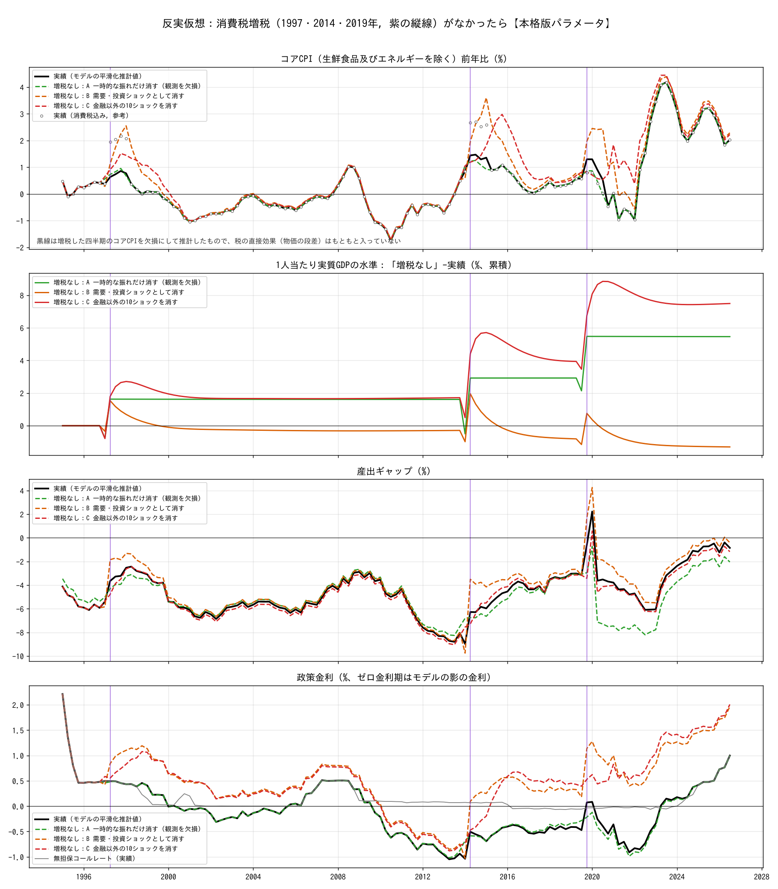

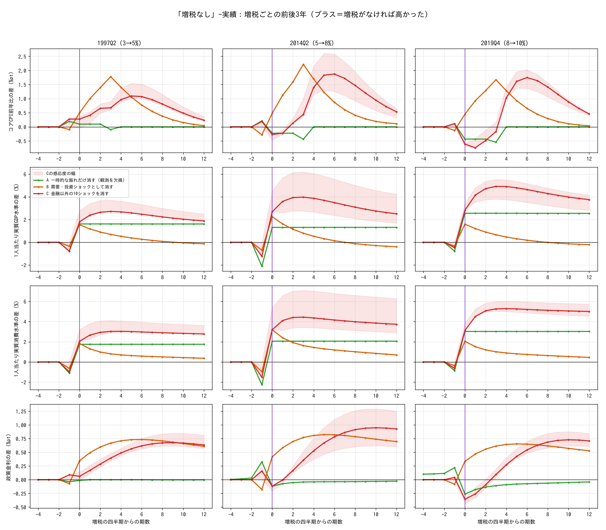

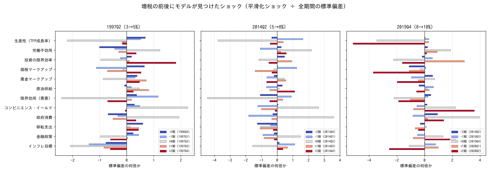

数値は [data/cf_tax_jp_summary.csv](data/cf_tax_jp_summary.csv)（その回の増税だけを消した効果）、
経路は [data/cf_tax_jp.csv](data/cf_tax_jp.csv)、ケースCのショック別内訳は [data/cf_tax_jp_by_shock.csv](data/cf_tax_jp_by_shock.csv)。

## 結果（増税の8四半期後、「増税なし」−実績）
| 増税 | ケース | コアCPI前年比 | 1人当たり実質GDP水準 | 実質消費水準 | 政策金利 |
|---|---|---|---|---|---|
| 1997 | A 一時的 | 0.0 | +1.6% | +1.8% | 0.0 |
| | B 需要 | +0.4（ピーク+1.8） | +0.1% | +0.5% | +0.7 |
| | C 金融以外全部 | +0.8 | +2.2% | +2.9% | +0.7 |
| 2014 | A 一時的 | 0.0 | +1.3% | +2.1% | 0.0 |
| | B 需要 | +0.4（ピーク+2.2） | −0.1% | +1.0% | +0.8 |
| | C 金融以外全部 | +1.5 | +3.1% | +4.0% | +0.9 |
| 2019 | A 一時的 | 0.0 | +2.6% | +3.0% | −0.1 |
| | B 需要 | +0.3（ピーク+1.7） | 0.0% | +0.6% | +0.6 |
| | C 金融以外全部 | +1.4 | +4.3% | +5.1% | +0.7 |

- **GDP**: 増税の2四半期だけを消しても（A）、GDPの水準は1.3〜2.6%高かった。駆け込みより反動減のほうが大きく、
  落ちた分が戻らないまま推移した、という読み方。Cでは2〜4%で、その大半は**TFP（生産性）ショック**を消した効果
  （`cf_tax_jp_by_shock.csv`）。TFPはランダムウォークなので、消すと水準がずっと高いままになる。
- **コアCPI**: 増税の直接効果（物価の段差）はもともと推計に入っていない（増税の四半期のコアCPIを欠損にしている）。
  そのうえで、B・Cでは需要が冷えなかった分、1〜2年後のコアCPIが最大+1.7〜2.2%pt高かった。
- **政策金利**: B・Cでは+0.6〜0.9%pt高い。ただし2014年と2019年はゼロ金利期なので、これは「影の金利」の差で、
  実際のコールレートが上がったという意味ではない。

## 限界
- **モデルに消費税がない**ので、増税の効果は「増税の四半期に出たショック」としてしか拾えない。同じ四半期に起きた
  別の出来事（1997年秋の金融危機の前触れ、2014年の円安、2019年の台風・米中摩擦）と区別できない。
- 日本ではTFPを観測していないので、モデルはGDPの大きな落ち込みを**TFPの恒久的な低下**として説明しやすい。
  ケースCのGDPの効果はこの仕組みでふくらんでいる可能性が高い。
- 増税は予告されたイベントだが、モデルのショックはすべて「サプライズ」。駆け込みを予想に基づく行動として再現できない。
- 実質値は名目値をGDPデフレーターで割っているので、増税で消費のデフレーターがGDPデフレーターより大きく上がった分、
  実質消費の落ち込みが大きめに出る。
- 2019Q4の増税のすぐ後にCOVIDが来ているので、2020年以降の差は特に幅を持って見たい。
