# 日本版 歴史分解（お試し版と本格版）

米国で推定されたセントルイス連銀DSGEの事後平均パラメータを**そのまま**使い、日本の観測データをカルマン平滑化にかけて
構造ショックを取り出し、コアCPIなどを歴史分解したもの。パラメータは日本で推定し直していないので、結果は「形を見るための試算」。

## 図

### コアCPI（生鮮食品及びエネルギーを除く総合、前年比）の歴史分解 1995〜2026Q3


### 2019Q4以降：コアCPI・GDP成長率・産出ギャップ・自然利子率


### 政策金利：モデルの推計値（ゼロ金利期は影の金利）とコールレート


## ファイル
| ファイル | 内容 |
|---|---|
| `data_jp.py` | ESRI・e-Stat・FRED から観測データを取得して `data/observables_jp.csv` を作る |
| `hd_jp.py` | カルマン平滑化と歴史分解。親フォルダの `stlouis_dsge.py`・`hd.py` を再利用 |
| `figures/hd_jp_core_cpi.png` | コアCPI（生鮮食品及びエネルギーを除く総合、前年比）の歴史分解 1995〜2026Q3 |
| `figures/hd_jp_since2019.png` | 2019Q4以降のコアCPI・GDP成長率・産出ギャップ・自然利子率の分解 |
| `figures/hd_jp_shadow_rate.png` | モデルが推計した政策金利（ゼロ金利期は影の金利）とコールレート |

```
FRED_API_KEY=xxxx ESTAT_APP_ID=yyyy python jp/data_jp.py
python jp/hd_jp.py
```

## 観測データ（1994Q1〜2026Q3）
| モデルの観測 | 日本で使った系列 | 出典 |
|---|---|---|
| 1人当たり実質GDP・消費・投資・政府消費の成長率 | 名目季調（GDP、民間最終消費、民間住宅＋民間企業設備、政府最終消費）÷GDPデフレーター÷人口 | ESRI QE（2026年7-9月期1次速報） |
| 実質賃金の伸び | 雇用者報酬（名目季調）÷GDPデフレーター÷就業者数 | ESRI QE、FRED `LFEMTTTTJPQ647S` |
| 労働時間 | 就業者数÷人口（1人当たり労働時間は入れていない） | FRED |
| 政策金利 | 無担保コールレート。**0.25%以下の四半期は欠損** | FRED `IRSTCI01JPM156N` |
| コアインフレ | CPI 生鮮食品及びエネルギーを除く総合（2010年〜は公式季調値、それ以前は原系列を簡易季調して接続） | e-Stat `0003427113` |
| ガソリン価格 | CPI ガソリン（簡易季調） | e-Stat |
| 原油価格 | WTI×円ドル÷GDPデフレーター（対数・平均除去） | FRED |
| 移転支出・TFP・10年インフレ期待・10年金利・CY | 使わない（全期間欠損） | — |

人口は世界銀行の年次総人口（FRED `POPTOTJPA647NWDB`）を四半期に補間し、HPトレンドで均した。

## 日本向けの工夫
- **ゼロ金利・マイナス金利**: モデルは線形でゼロ金利制約を持たない。コールレートが0.25%以下の期間は観測から外し、
  政策金利はモデルの中で自由に動く「影の金利」にした。
- **消費税率引き上げ**（1997Q2・2014Q2・2019Q4）: その四半期のコアCPIとガソリンの前期比を欠損にした。
  分解図の黒線は税の影響を除いた値、白丸は税込みの実績（参考）。
- **トレンド成長率の違い**: 実質成長率・賃金・労働時間・ガソリンの観測方程式の定数を日本のサンプル平均にした。
  モデルのトレンドは米国のままなので、日本の低成長を恒常的なショックと誤認しないための調整。
- **インフレの定常状態は2%のまま**: 日銀の物価安定の目標と同じ。図は「2%からの乖離」で、政策金利の定常状態は3.15%。

## 結果の読み方（お試し版）
- 1995〜2012年のコアCPIは2%を2〜3%pt下回り続けた。モデルはこれを主に**金融（インフレ目標ショック＝トレンド
  インフレの低下）**と**需要**で説明し、2009〜10年の落ち込みは需要・TFP（供給）も大きい。
- 2021〜22年の大きなマイナスは供給（TFP）と需要。携帯電話通信料の値下げ（2021年4月）は、このモデルでは供給側として現れる。
- 2023年以降のプラスは、**金融（インフレ目標ショック＋1.1〜1.2%pt、金融政策ショック＋0.6〜0.9%pt）**が中心。
  トレンドインフレが上がったうえに、政策金利がルールより低く据え置かれた（緩和的だった）という解釈になる。
- 影の金利は四半期ごとの振れが大きい。米国推定の金融政策ショックは持続性が低い（ρ=0.07）ため。

## 限界
- パラメータは米国の推定値。価格・賃金の硬直性、テイラー則の係数、ショックの大きさは日本と違う可能性が高い。
- 閉鎖経済モデルで為替・輸入物価の経路がない。2022〜23年の円安・輸入物価上昇は、供給や金融など別のショックに割り振られる。
- ゼロ金利は「観測を外す」だけの簡易対応。時変パラメータやOccBin等による本格的な扱いではない。
- 1人当たり労働時間、移転支出、インフレ期待、長期金利を観測に入れていないので、識別は米国版より弱い。
- 期首の初期値の影響（図の「その他」）が数年残る。

## お試し版の時点での所見：本格版に進むべきか
進める価値は高い。お試し版でも「長期の低インフレ＝トレンドインフレ（期待）の低さ」「2023年以降の上昇＝トレンドインフレの
上昇と緩和的な金利」という、日本の議論と整合的な形が出た。一方で、金融ショックの振れの大きさや影の金利のノイズは、
米国パラメータが日本に合っていないことを示している。本格版では次の順で進めるのがよい。
1. 日本データでの事後モード推定（硬直性、テイラー則、ショックの持続性と大きさ）
2. ゼロ金利の扱いの改善（影の金利を観測に使う、またはゼロ金利期の期待金利経路を制約する）
3. 為替・輸入物価を入れた開放経済化、またはエネルギー以外の輸入物価ショックの追加
4. 日銀短観の物価見通し・10年国債利回り（YCC期間は除く）を観測に追加

---

# 本格版：日本データでのベイズ推定

お試し版と同じ観測データ（10系列, 1994Q2〜2026Q3）で、パラメータ37個をベイズ推定し、歴史分解を作り直した。

```
python jp/estimate_jp.py mode          # 事後モード（L-BFGS-B、止まったら再起動。途中経過は estimation/mode_progress.json）
python jp/estimate_jp.py hessian       # モードでのヘッセ行列
python jp/estimate_jp.py mcmc 15000 4  # ランダムウォーク・メトロポリス 4チェーン（500回ごとに保存、再実行で続きから）
python jp/estimate_jp.py summary       # estimation/posterior_summary.csv
python jp/hd_jp_est.py                 # 本格版の歴史分解と比較図（既定は事後平均。`python jp/hd_jp_est.py mode` でモード）
```

**クリーンチェックアウトでの再生成**: MCMCチェーン本体（`estimation/chain*.npz`）はGit管理外。`hd_jp_est.py` の事後平均は
チェーン → `estimation/posterior_mean.csv`（`summary` が全精度で書く）→ 公開している `estimation/posterior_draws_thin10.csv`
（4,200ドロー）の平均、の順で探し、どれも無ければ止まる（モードには切り替えない）。使ったパラメータの出どころは標準出力と
`data/historical_decomposition_jp_est.source.txt` に書く。掲載の歴史分解CSV・図は全チェーン（42,000ドロー）の平均で作ったもので、
間引きドローの平均で再生成すると差は最大0.003%pt程度（2023年以降の金融寄与はどちらも +1.22%pt）。
`posterior_summary.csv` の事後平均は小数4桁に丸めてあり、小さい標準偏差（sig_mp など）がずれるので再生成には使わないこと。

## 推定の設定
- **推定するもの（37個）**: 価格・賃金の調整コスト（etap, etaw）、指数化（iotap, iotaw）、投資調整コスト、稼働率、
  労働供給の弾力性、テイラー則（phiPi, phiY, rhor）、10個のショックの持続性と標準偏差、マークアップのMA項、
  COVIDショック2個の大きさ、測定誤差3個（GDP・ガソリン・原油）。
- **固定するもの**: 定常状態を決めるパラメータ（トレンド成長率、割引率、インフレ目標2%、財政比率など）と、観測しない
  移転支出・コンビニエンス・イールドのショック過程は米国の値のまま。
- **事前分布**: 米国の事後平均を中心に置いた（米国の推定値を出発点に日本のデータで更新する考え方）。
  0〜1のパラメータはベータ分布（標準偏差0.1〜0.15）、正のパラメータはガンマ分布（標準偏差は平均の30〜40%）、
  ショックの標準偏差は対数正規（対数の標準偏差1）。
- **アルゴリズム**: カルマンフィルターで尤度を計算（数値安定のため共分散を毎期対称化し、コレスキー分解で解く）。
  事後モードのヘッセ行列を提案分布にしたランダムウォーク・メトロポリスを4チェーン×15,000回（採択率0.33〜0.34）。
  最初の30%を捨てて42,000ドロー。Gelman-Rubin の R-hat は全パラメータで1.06未満（37個中34個は1.02未満）。

## 推定結果（米国との違いが大きいもの）
| パラメータ | 意味 | 米国 | 日本（事後平均, 90%区間） |
|---|---|---|---|
| etap | 価格の調整コスト | 77.9 | **17.6**（13.0〜23.5） |
| iotap | 価格の過去インフレへの指数化 | 0.26 | **0.07**（0.02〜0.16） |
| iotaw | 賃金の指数化 | 0.76 | **0.33**（0.14〜0.60） |
| rhor | 政策金利の慣性 | 0.81 | **0.96**（0.95〜0.98） |
| sig_mp | 金融政策ショックの大きさ | 0.0024 | **0.0005**（0.0004〜0.0007） |
| sig_mup | 価格マークアップショックの大きさ | 0.029 | **0.010**（0.009〜0.012） |
| psii | 投資の調整コスト | 1.95 | 2.86（2.00〜3.94） |
| phiPi, phiY | テイラー則のインフレ・GDP反応 | 2.85, 0.76 | 2.71, 0.71（ほぼ事前分布のまま） |

全パラメータの表は [estimation/posterior_summary.csv](estimation/posterior_summary.csv)。

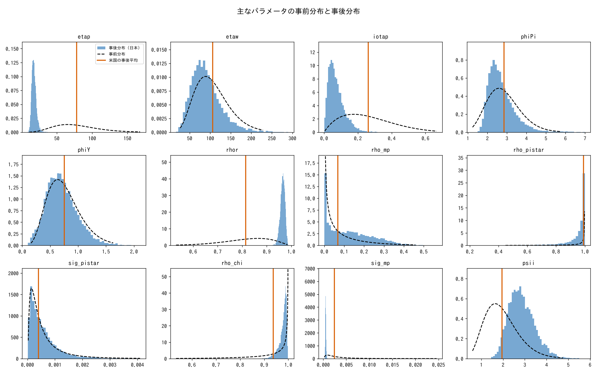

読み方
- 日本の価格は米国より**調整コストが小さく、過去のインフレにほとんど連動しない**。コアCPIは前期の値に引きずられにくく、
  その時々のショックに素直に反応する形になった。賃金の指数化も米国の半分以下。
- 金融政策は**金利の慣性が非常に強く（0.96）、予想外の金利変更（金融政策ショック）は米国の5分の1**。
  長いゼロ金利と小刻みな利上げという日本の経験と合っている。
- テイラー則の反応係数は事前分布からほとんど動いていない。ゼロ金利期の金利を観測から外しているので、データに情報が少ない。

## 本格版の歴史分解

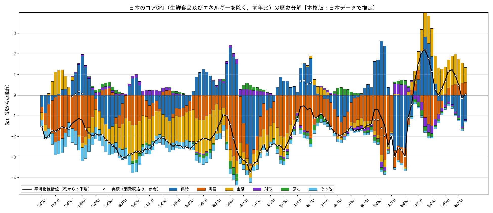


| 期間 | お試し版（米国パラメータ） | 本格版（日本で推定） |
|---|---|---|
| 1995〜2012年（平均 −2.3%pt） | 金融 −0.80、その他 −0.79、需要 −0.58 | **需要 −1.00、金融 −0.81**、その他 −0.40 |
| 2013〜2021年（平均 −1.6%pt） | 需要 −0.90、その他 −0.49 | **需要 −1.38** |
| 2023〜2026Q3（平均 +0.9%pt） | **金融 +1.88**、需要 −0.51 | **金融 +1.22**、供給 +0.28、需要 −0.20 |

- **デフレ期**: 「需要不足」と「金融（トレンドインフレの低さと引き締め気味の金利）」が半々。お試し版より需要の比重が上がり、
  初期値の影響（その他）が半分になった。
- **異次元緩和期**: 2%に届かなかった理由はほぼ「需要」。金融の寄与はほぼゼロで、緩和をしてもインフレが上がらなかった
  原因をモデルは需要側の弱さに求めている。
- **2023年以降**: 「金融」が主役なのは変わらないが、+1.9→+1.2%ptに縮んだ。2023年のピークには供給（TFP）の寄与も大きい。
  なお需要グループの中の「コンビニエンス・イールド」ショック（パラメータ固定・観測なし）が2024年以降に+1%pt前後出ており、
  これは他で説明しきれない部分を拾っている可能性がある。

### 2019Q4以降：コアCPI・GDP成長率・産出ギャップ・自然利子率（本格版）
お試し版の [hd_jp_since2019.png](figures/hd_jp_since2019.png) と同じ形。


- **コアCPI**: 2020年の上振れは供給、2021〜22年の落ち込みは供給（携帯料金の値下げなど）と需要。2023年のピークは
  供給と金融、2024年以降は金融が+1〜1.5%ptで支えている。
- **産出ギャップ**: 2022年末の−6%から2026年には−1%前後まで縮小。お試し版では2023年以降プラスだったが、本格版では
  マイナス圏のまま。ただし「その他」（期首の初期値の影響）が−1.5%ほど残っている点に注意。持続性がほぼ1のショック
  （政府消費・価格マークアップ・原油）があるため、初期値の影響がなかなか消えない。
- **自然利子率 r***: コロナ期に大きく振れた後、2023〜25年は供給（TFP）の押し上げでプラス、2026年にはほぼ定常状態に戻った。
  四半期ごとの r* は振れが大きいので、方向感を見る程度にとどめたい。

### 自然利子率 r* の読み方（水準版）
上の4パネル図の r* は「**定常値からの乖離**」。定常値とは、ショックが何も起きていない長期の平均的な状態での値で、
このモデルでは **年率1.16%**（トレンド成長率・割引率など米国の設定から決まる）。水準は「1.16%＋乖離」で読む。


- このモデルの r* は「価格がすぐ動く仮想経済で、次の四半期に成り立つ実質金利」。景気の短期的な強さで大きく動くので、
  ±10%を超える振れも出る。日銀や Laubach-Williams 型の「中長期の自然利子率（0%前後）」とは別物で、
  四半期の値ではなく太線（4四半期平均）で方向感を見るのがよい。
- 定常値1.16%は米国のトレンド成長率（1人当たり年1.9%）を前提にしている。日本の平均成長率（年0.8%）はそれより1.0%pt
  低いので、その分を差し引いた **0.12%**（点線）を日本の目安として併記した（成長率と自然利子率が1対1で動くと仮定した粗い補正）。
- 水準で見ると、2012〜13年と2021〜22年は−10%を超える大幅なマイナス（実際の金利をゼロにしても引き締め的）、
  2024〜25年は+5%前後のプラス（低い金利は強い緩和）。2026年は+2%程度まで下がってきている。
- 数値は [data/rstar_level_jp_est.csv](data/rstar_level_jp_est.csv)。

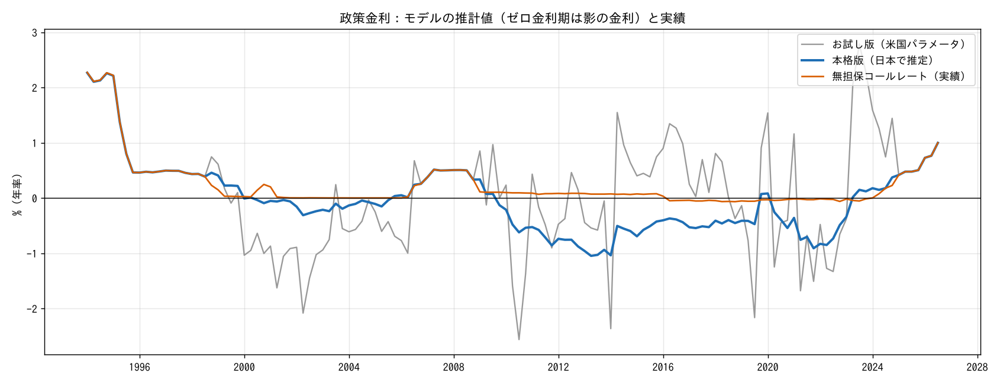

- **影の金利が落ち着いた**: お試し版では四半期ごとに±2%も振れていたが、本格版では滑らかになり、
  2000年代前半は0〜−0.3%、2010〜2013年と2020〜22年は−1%前後と、量的緩和期に「実質的にマイナス金利だった」形になった。

## 本格版の限界と次の一歩
- 事前分布を米国の値の周りに置いているので、データの情報が少ないパラメータ（テイラー則など）は米国の値に近いまま。
- 持続性の事前分布で平均が0や1に近いもの（rho_mp, rho_chi など）は、ベータ分布が端に張り付く形になっている。
- 開放経済の要素（為替・輸入物価）、10年国債利回りや短観の物価見通しの観測はまだ入れていない（お試し版の README の手順3・4）。
- ゼロ金利は「観測から外す」だけの扱いのまま。

---

# 日本版インパルス応答（IRF）と米国との比較

IRF（インパルス応答）は「ショックが1回だけ起きたら、その後の経済がどう動くか」をモデルとパラメータだけで計算したもの。
観測データは使わないので、米国パラメータのままでは米国版と同じになる。ここでは本格版で推定した**日本の事後平均パラメータ**で
12ショックのIRFを描き、米国版（論文の事後平均）と重ねた。

```
python jp/irf_jp.py            # 事後平均（hd_jp_est.py と同じ探し方。クリーンチェックアウトでは間引きドロー4,200個の平均）
python jp/irf_jp.py mode       # 事後モード
```

- ショックの大きさは日米それぞれの**1標準偏差**。インフレの定常状態は日米とも2%、政策金利（日本はコールレート、米国はFF金利）の
  定常状態は3.15%（推定で固定したパラメータで決まるので共通）。
- 移転支出とコンビニエンス・イールドのショック過程は米国の値のまま固定しているが、価格の硬直性などが違うので応答の形は変わる。
- 衝撃時・ピーク・半減期の数値は [data/irf_jp_us_summary.csv](data/irf_jp_us_summary.csv)。

## 図（青の実線=米国、赤の破線=日本、点線=定常状態）
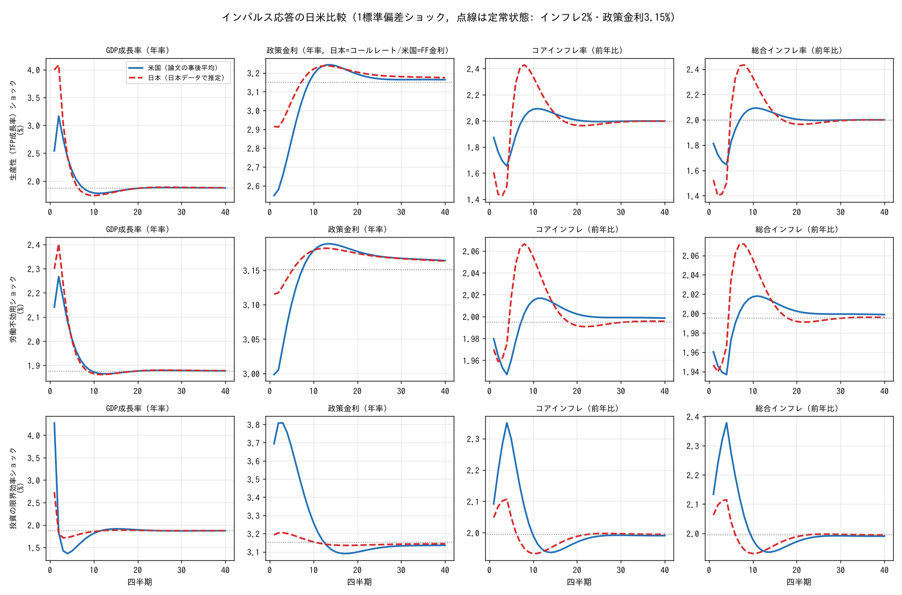
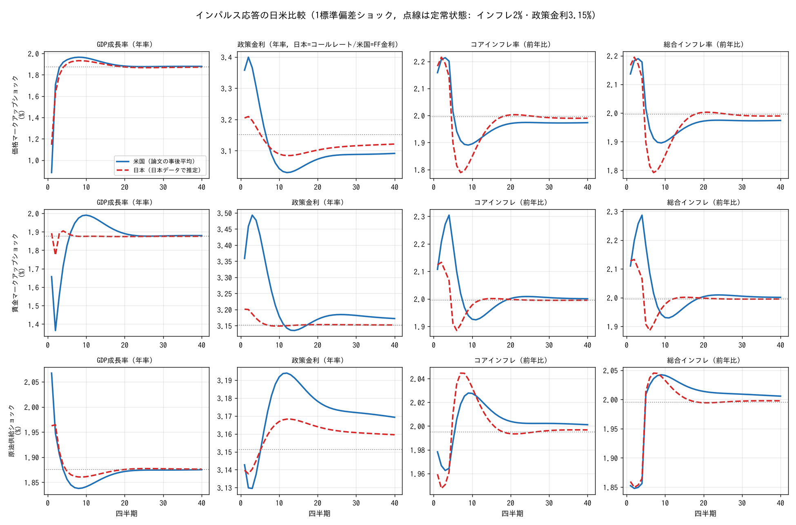

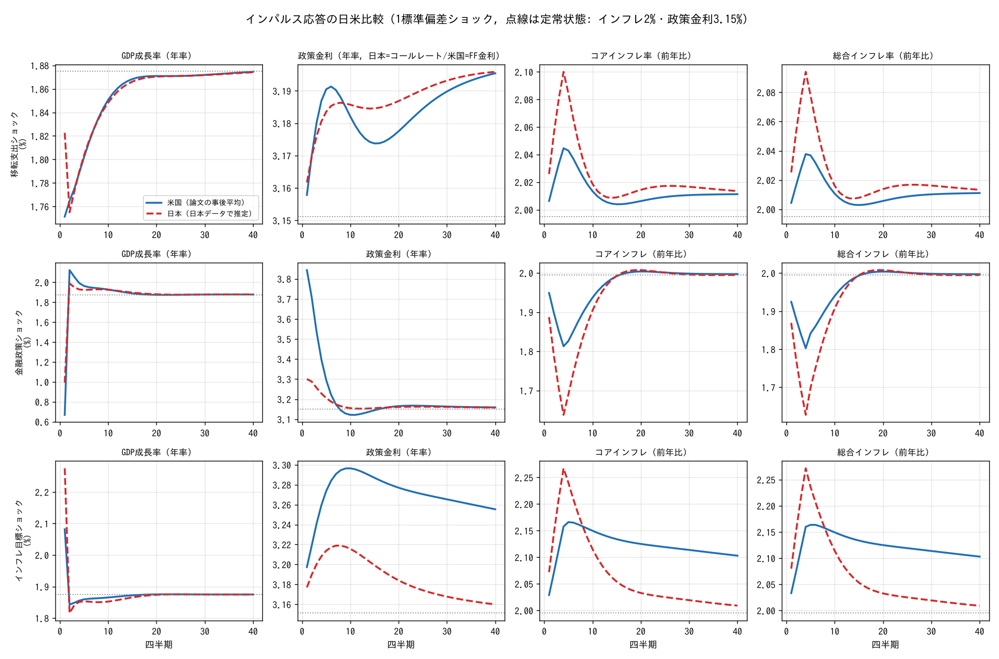
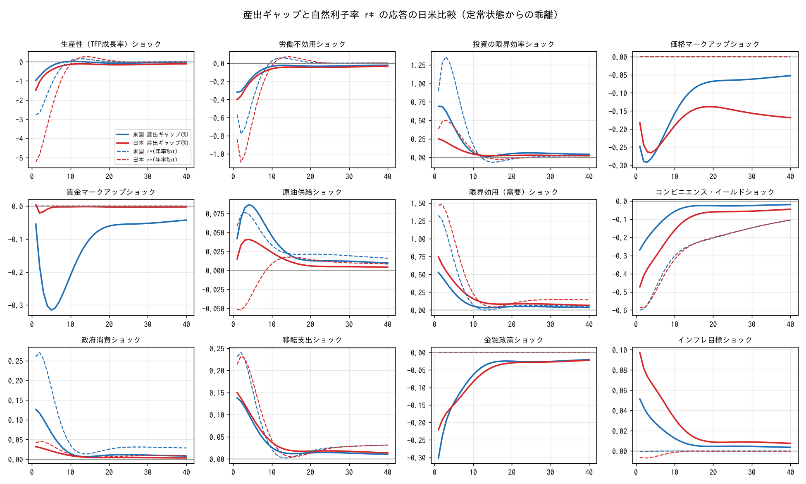


## 日米で大きく違うところ
| ショック | 米国 | 日本 | 理由（推定パラメータ） |
|---|---|---|---|
| 金融政策（1標準偏差） | 政策金利 +0.69%pt、コアインフレ最大 −0.18%pt、GDP成長率 −1.2%pt | 政策金利 **+0.15%pt**、コアインフレ最大 **−0.36%pt**、GDP成長率 −0.9%pt | 予想外の金利変更が米国の5分の1（sig_mp） |
| 金融政策（政策金利 +1%pt にそろえる） | コアインフレ最大 −0.26%pt、産出ギャップ最大 −0.44% | コアインフレ最大 **−2.4%pt**、産出ギャップ最大 **−1.5%** | 価格の調整コストが米国の4分の1（etap 78→18）で物価がすぐ動く。過去のインフレへの指数化もほぼゼロ（iotap 0.26→0.07）。金利の慣性が強く（rhor 0.81→0.96）利上げが長く続く |
| インフレ目標（トレンドインフレ） | ピーク +0.17%pt、10年後も +0.10%pt 残る | ピーク **+0.27%pt**、半減期 **6四半期**で消える | 持続性が低い（rho_pistar 0.990→0.944）。日本の「期待インフレの上振れ」は定着しにくい |
| 需要（限界効用） | コアインフレ最大 +0.19%pt | コアインフレ最大 **+0.53%pt**、政策金利は10年後も高止まり | ショックが大きく（sig_chi 0.022→0.056）持続的（rho_chi 0.94→0.98）、価格も動きやすい |
| 投資の限界効率 | GDP成長率 +2.4%pt、政策金利 +0.66%pt | GDP成長率 +0.9%pt、政策金利 +0.05%pt | ショックが半分（sig_zeta 0.070→0.036）、投資の調整コストが大きい（psii 1.95→2.86） |
| 政府消費 | GDP成長率 +0.43%pt | GDP成長率 +0.10%pt | 持続性がほぼ1（rho_g 0.9997）で、1回の衝撃は小さく長く続く形 |
| 価格マークアップ | 政策金利・インフレが数四半期で戻る | ショックが3分の1（sig_mup 0.029→0.010）で、総合インフレは2年弱でマイナスに振れる | 持続性がほぼ1（rho_mup 0.999）と価格の柔軟さ |
| TFP（生産性） | GDP成長率 ピーク +1.3%pt | GDP成長率 衝撃時 **+2.1%pt**、コアインフレ最大 −0.57%pt | ショックが大きく（sig_GZ 0.008→0.014）、価格がすぐ下がる |

## 読み方の注意
- 「日本では金融政策が**効きにくい**」という直感とは逆に、このモデルでは政策金利1%ptあたりの効果は日本のほうが**ずっと大きい**。
  日本の推定は価格が柔らかい（フィリップス曲線が急）ので、同じ金利変更で物価が大きく動く。ただし日本で実際に起きる
  予想外の金利変更は小さい（1標準偏差 0.15%pt）ので、+1%ptへの換算は「線形モデルでの外挿」と考えたい。
- 推定ではコールレートが0.25%以下の期間（ゼロ金利・マイナス金利）を観測から外している。金融政策ショックの大きさや
  テイラー則は、金利が動いていた短い期間（主に1990年代後半・2006〜08年・2024年以降）からしか学んでいない。
  実際の日本で「金融政策が効きにくい」と言われるのは主にゼロ金利で**金利を下げられない**ことで、このモデルはそれを扱っていない。
- テイラー則の係数（phiPi, phiY）は事前分布（米国の値）からほとんど動いていないので、日米の違いはほぼ慣性 rhor から来ている。

---

# 実質賃金の歴史分解（本格版）

日本データで推定したパラメータ（事後平均）を使い、**実質賃金の伸び**を、コアCPIと同じ5グループ（供給・需要・金融・財政・原油）と
「その他」（期首の初期値＋測定誤差）に分けた。

```
python jp/hd_jp_wage.py
```

| ファイル | 内容 |
|---|---|
| `hd_jp_wage.py` | 実質賃金の歴史分解（前年比・水準・ショック別）。`hd_jp_est.py` の `posterior_theta`・`run_est` を再利用 |
| `figures/hd_jp_wage_yoy.png` | 前年比の歴史分解 1995〜2026Q3 |
| `figures/hd_jp_wage_level.png` | 水準（トレンドからの累積乖離）2012Q4＝0 と 2021Q4＝0 |
| `figures/hd_jp_wage_shocks.png` | 2013年以降・2022年以降の累積をショック別に |
| `data/hd_jp_wage.csv` / `data/hd_jp_wage_by_shock.csv` | 図の数値（グループ別・ショック別） |

## 何を分解しているか
- 観測の実質賃金は **雇用者報酬（名目）÷ GDPデフレーター ÷ 就業者数** の前期比年率。観測方程式の定数は日本のサンプル平均
  **年0.59%** にしているので、分解は「平均的な伸びからの乖離」。賃金は測定誤差なしで観測しているので、推計値は実績と一致する。
- **前年比** は前期比年率の4四半期平均（対数近似）。寄与は線形なのでグループごとにそのまま平均できる。
- **水準** は前期比年率÷4 を足し上げたもの。「年0.59%で伸び続けた場合のトレンド」から何％下にいるか、を基準期＝0で見る。
- モデルの観測方程式は「実質賃金の伸び ＝ 定常化した賃金 w の伸び ＋ TFP成長率 GZ」（式105）。**TFP成長のショックは
  1対1で、しかも恒久的に実質賃金の水準を動かす**。ほかのショックの影響はいずれ消える（w が定常状態に戻る）。

## 図
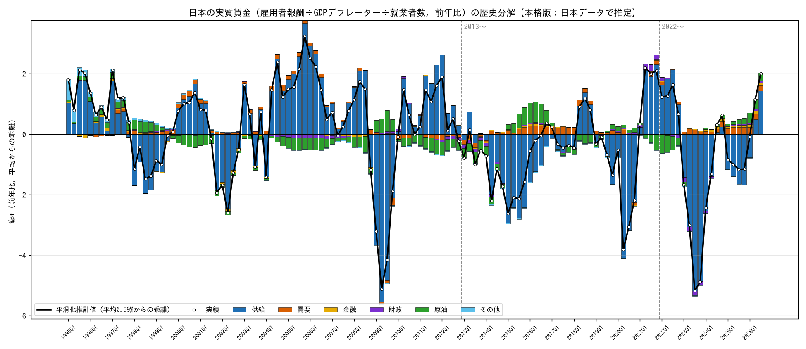

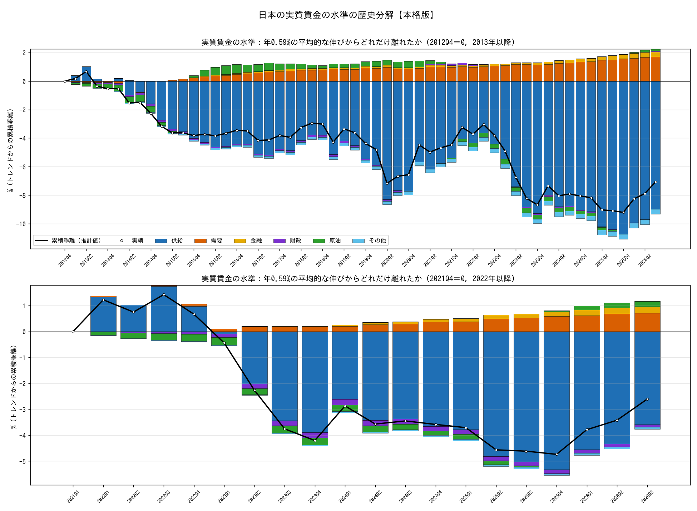

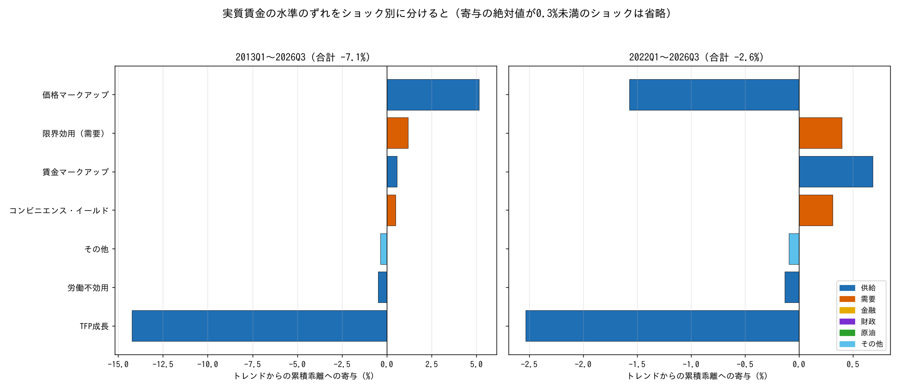

## 結果
| 期間 | 実績（平均0.59%からの乖離, 年率） | 主な寄与 |
|---|---|---|
| 1995〜2012年 | **+0.29%pt** | 供給 +0.38 |
| 2013〜2021年 | **−0.50%pt** | 供給 −0.60、需要 +0.11 |
| 2022〜2026Q3 | **−0.55%pt** | 供給 −0.76、需要 +0.15、金融 +0.05 |

水準で見ると（トレンドからの累積乖離）:

| 基準 | 2026Q3 の乖離 | 供給 | 需要 | 金融 | 財政 | 原油 | その他 |
|---|---|---|---|---|---|---|---|
| 2012Q4＝0 | **−7.1%** | −9.0 | +1.7 | +0.4 | 0.0 | +0.2 | −0.4 |
| 2021Q4＝0 | **−2.6%** | −3.6 | +0.7 | +0.3 | −0.1 | +0.2 | −0.1 |

ショック別（供給の中身）:

| ショック | 2013Q1〜2026Q3 | 2022Q1〜2026Q3 |
|---|---|---|
| TFP成長（GZ、恒久的） | **−14.2%** | **−2.5%** |
| 価格マークアップ（mup） | **+5.2%** | **−1.6%** |
| 賃金マークアップ（muw） | +0.6% | +0.7% |
| 限界効用（需要, chi） | +1.2% | +0.4% |

- **2013年以降の低迷は、ほぼ「供給」**。中身は「TFP成長が平均より低かった」こと（−14%）で、2016〜2020年の
  価格マークアップの低下（＝GDPデフレーターが賃金コストほど上がらなかった, +5%）が一部を打ち消した。
  需要・金融（異次元緩和）・財政の寄与は小さく、需要と金融はむしろ少しプラス。モデルの言い分は
  「金融緩和や需要は実質賃金をほとんど動かしておらず、**生産性の伸びの弱さ**が実質賃金を押し下げてきた」。
- **2022年以降**: 2022年は前年比でプラス、**2023年に前年比 −4.9%pt の大きな落ち込み**。2023年の内訳は
  TFP −2.0、価格マークアップ −1.6、賃金マークアップ −1.1（いずれも供給）。2022年はGDPデフレーターが
  輸入物価高でむしろ伸び悩み（交易条件の悪化はGDPデフレーターを下げる）、2023年に輸入物価が落ち着くと
  国内の価格転嫁でGDPデフレーターが大きく上がった。名目賃金がそれに追いつかなかった分を、モデルは
  「企業の価格マークアップが上がった」「賃金の伸びが弱かった」と読んでいる。
- **2024年以降**: 賃金マークアップのプラス（春闘の高い賃上げ）と需要・金融のプラスが少し支えているが、TFPのマイナスが続き、
  2025年末に水準は2021Q4比−4.7%まで下がった。2026年に入って持ち直し、2026Q3は−2.6%。

## 学習ポイント
- **恒久ショックと一時的ショック**: 実質賃金の水準を長く動かせるのは、このモデルでは TFP成長（ランダムウォーク）だけ。
  需要や金融政策は「一時的に名目賃金と物価の伸びをずらす」ことしかできないので、累積で見ると寄与が小さくなる。
  「金融緩和で実質賃金は上がるか」に対するDSGEの基本的な答えが「長くは動かせない」なのはこのため。
- **TFPは観測していない**: 日本版では TFP の系列を使っていないので、「TFP成長」は GDP・消費・投資・賃金が
  そろって弱いときに、モデルが「恒久的な生産性の低下」として拾ったもの。人口減少下の労働の質、非正規化
  （就業者1人当たりで見ているので短時間労働者が増えると下がる）なども、ここに入っている可能性が高い。
- **どのデフレーターで割るか**: ここでの実質賃金は GDPデフレーターで割っている。厚労省の毎月勤労統計の実質賃金は
  消費者物価（持家の帰属家賃を除く総合）で割るので、輸入物価が上がった2022年は毎勤のほうが大きく落ち込む。
  モデルは閉鎖経済で交易条件を持たないので、「消費者から見た実質賃金」と「生産者から見た実質賃金」の差は説明できない。

## 限界
- 閉鎖経済のモデルなので、輸入物価・為替・交易条件の影響は「価格マークアップ」や「TFP」に紛れ込む。
- 1人当たり（就業者数で割った）賃金なので、労働時間の短縮やパートタイム比率の上昇が「賃金の伸びの弱さ」として現れる。
  時間当たり賃金で見ると結果は変わりうる。
- 2014・2019年の消費税増税はGDPデフレーターを押し上げるので、その期の実質賃金の落ち込みは供給ショックとして出る。

---

# 検討：日本のTFPのデータを観測に足すと、実質賃金の分解は変わるか

上の実質賃金の分解では「TFP成長」が主役になった。ただし日本版は TFP の系列を観測していないので（米国版は Fernald の
四半期TFPを観測）、この「TFP」は他の系列から**推理された**もの。そこで、実際に測った日本の TFP を観測に足して確かめた。

```
FRED_API_KEY=xxxx python jp/tfp_jp.py fetch   # データ取得（data/tfp_pwt_jp.csv、コミット済み）
python jp/tfp_jp.py
```

## やり方
- **データ**: Penn World Table 11.0 の日本の TFP（FRED `RTFPNAJPA632NRUG`）と労働分配率（`LABSHPJPA156NRUG`）。年次、2023年まで。
  稼働率の調整はしていない。モデルの TFP は労働増大型なので、TFP の伸びを労働分配率で割って変換し（Fernald と同じ考え方）、
  1995〜2023年の平均（年0.05%）を引いた。
- **年次を四半期モデルに入れる**: 年平均の水準の伸びは、四半期の伸び（年率）の7四半期の三角加重平均（1,2,3,4,3,2,1）/16。
  TFP成長率 GZ の6期分のラグを状態に足し、各年の第4四半期にだけ観測がある形にした。
- **測定誤差**を i.i.d. で入れ、標準偏差 1%pt（基本）、0.25%pt、0.03%pt（データに強く寄せる）の3通り。
- パラメータは本格版の事後平均のまま（**推定し直していない**）。

## 図
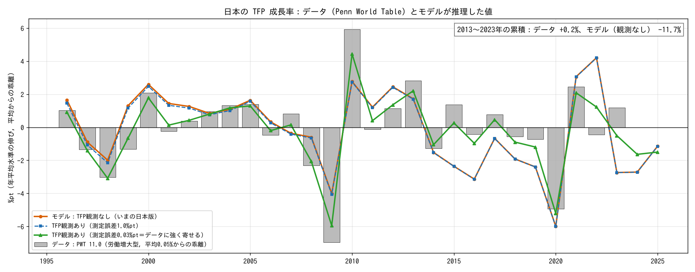

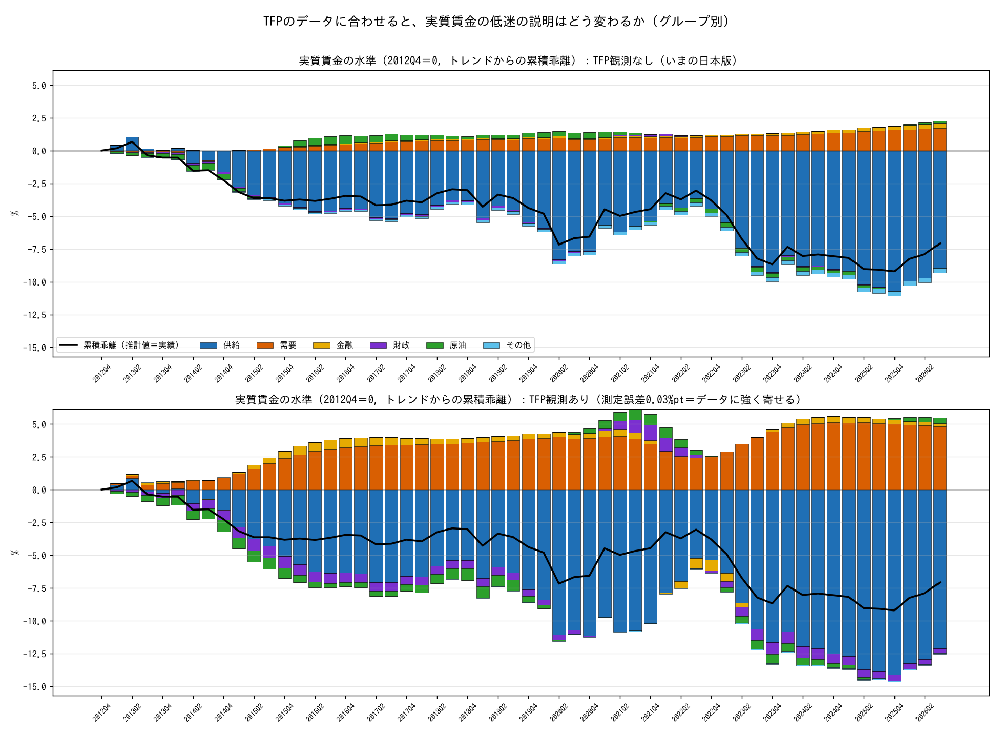

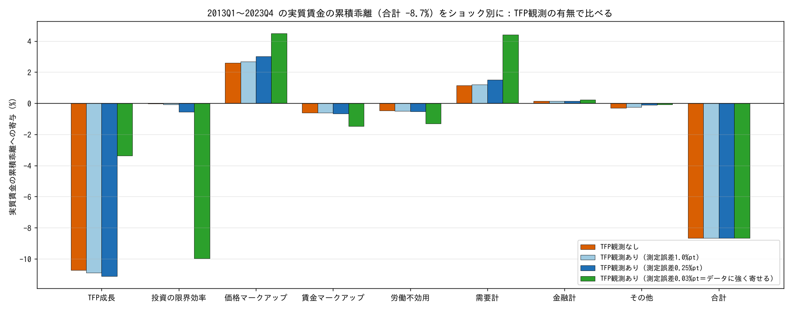

## 結果
**1. データとモデルの「TFP」は、2013年以降まったく違う。** 2013〜2023年の累積で、PWT の TFP は平均並み（**+0.2%**）なのに、
モデルが推理した TFP は平均を **−11.7%** 下回る。2015〜16年、2018〜19年、2022〜23年でとくにずれが大きい。

**2. 現実的な測定誤差（1%pt）で足しても、分解はほとんど変わらない。** 推理された TFP はほぼ動かず、ずれは測定誤差が吸収する。
ほかの10系列（とくに測定誤差なしで観測している賃金・消費・労働時間）が GZ をきつく決めているから。

**3. データに強く寄せると（0.03%pt）、主役が「投資の限界効率」に移る。**

| 2013Q1〜2023Q4 の実質賃金の累積乖離（合計 −8.7%） | TFP観測なし | 測定誤差1%pt | 0.25%pt | 0.03%pt（強く寄せる） |
|---|---|---|---|---|
| TFP成長 | −10.7 | −10.9 | −11.1 | **−3.4** |
| 投資の限界効率 | 0.0 | −0.1 | −0.6 | **−10.0** |
| 価格マークアップ | +2.6 | +2.7 | +3.0 | +4.5 |
| 賃金マークアップ | −0.6 | −0.6 | −0.7 | −1.5 |
| 需要計 | +1.2 | +1.2 | +1.5 | +4.4 |
| 対数尤度（参考：観測なしは −2957） | — | −3038 | −3751 | −22295 |

- 「生産性は平均並みだった」と言われると、モデルは「投資が弱くて資本の積み上がり（資本装備率）が足りず、1人当たりの
  生産と賃金が伸びなかった」という話に切り替える。供給グループが主役なのは変わらない。
- ただし対数尤度が大きく下がる（−2957 → −22295）。いまのパラメータのままでは、TFPのデータと他の系列を同時に
  説明するのはかなり無理がある。

## わかったこと
- 実質賃金の分解に出てくる「TFP成長」は、**技術進歩そのものではなく「1人当たり実質賃金と生産にずっと残る弱さ」の受け皿**と
  読むのが正しい。
- この弱さの候補（モデルにないもの）:
  - **1人当たり労働時間の減少**: PWT の平均労働時間は 2012→2023年で −7.4%（1995〜2023年の平均ペースより −2.2%）。
    実質賃金を就業者1人当たりで観測しているので、短時間化がそのまま「賃金の弱さ」になる。TFP は労働時間で測るので影響されない。
  - **資本装備率の伸びの鈍化**（上の 0.03%pt ケースの読み）。
  - **交易条件・労働分配率**: 閉鎖経済のモデルには入っていない。
- PWT は稼働率を調整していない年次の値で、2023年までしかない。数字は幅を持って見たい。

## 次の一歩（候補）
1. **実質賃金を時間当たりにする**（毎月勤労統計の総実労働時間で割る）か、1人当たり労働時間を観測に足す。いちばん手軽で効果が大きいはず。
2. TFP を観測に入れたまま、測定誤差の大きさも含めて**推定し直す**（MCMC で数時間）。
3. 法人企業統計（四半期の固定資産）と稼働率指数で、Fernald 型の**四半期TFP**を自作する。

---

# 時間当たり実質賃金の歴史分解

上の検討で、実質賃金を「就業者1人当たり」で観測しているため、短時間化（パート比率の上昇・働き方改革）が
「賃金の弱さ」に混ざっている疑いが出た。そこで労働力調査の労働時間で割って **時間当たり** にして分解し直した。

```
ESTAT_APP_ID=yyyy python jp/hours_jp.py fetch   # データ取得（data/hours_lfs_jp.csv、コミット済み）
python jp/hours_jp.py
```

## データとケース
- 総務省「労働力調査」基本集計（四半期）の全産業・総数の **平均週間就業時間**（1985Q1〜2010Q4: statsDataId 0002060025、
  2011Q1〜: 0003031528）。data_jp.py と同じ簡易法で季節調整。2011Q1〜Q3 は震災で全国値が無いので前年・翌年の同じ四半期の平均で埋めた。
  就業者数で割っている今の系列と分母がそろう（毎月勤労統計の長期系列は e-Stat では2015年で止まっているため使わなかった）。
- **A** 1人当たり（いまの日本版）／ **B** 実質賃金だけ時間当たり／ **C** 実質賃金を時間当たり＋労働時間の観測も
  「就業者×時間÷人口」（モデルの n＝総労働時間とそろう。基本はこれ）。パラメータは本格版の事後平均のまま。

## 図
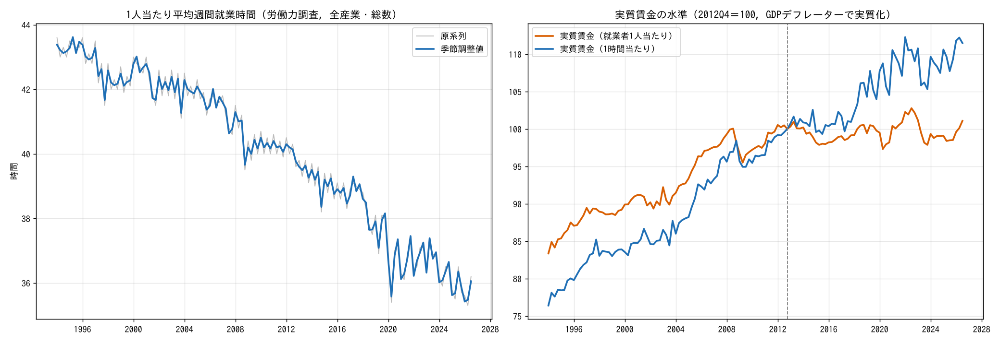

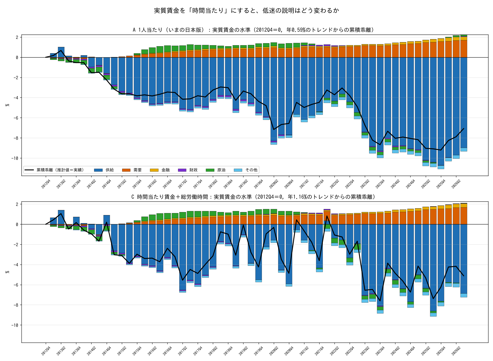

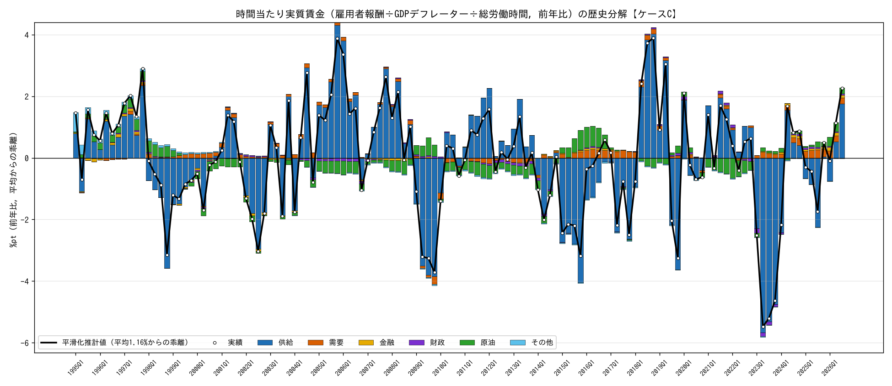

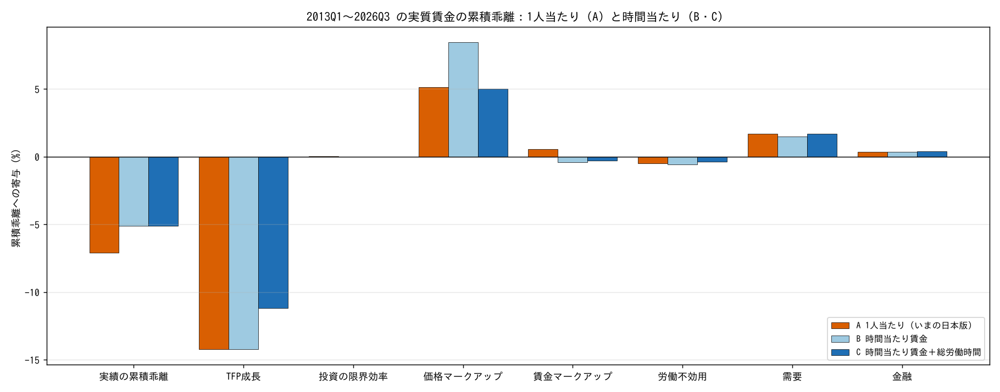

## 結果
- 1人当たり週間就業時間は 1994年の43時間から2026年の36時間へ。2013年以降の累積で −9.8%（ふだんのペース年−0.57%より −2.0%）。
- **時間当たりの実質賃金は、水準そのものは2012Q4から約+11%伸びている**（1人当たりはほぼ横ばい）。ただし時間当たりの
  トレンド（1994〜2026年の平均）は年1.16%と高いので、トレンド比では2026Q3に **−5.1%**（1人当たりは −7.1%）。
  短時間化で説明できるのは低迷の **約2%pt（3割弱）**。

| 2013Q1〜2026Q3 の累積乖離（%） | A 1人当たり | B 時間当たり | C 時間当たり＋総労働時間 |
|---|---|---|---|
| 実績 | −7.1 | −5.1 | −5.1 |
| 供給 | −9.0 | −6.8 | −6.9 |
| 　うち TFP成長 | −14.2 | −14.2 | −11.2 |
| 　うち 価格マークアップ | +5.2 | +8.4 | +5.0 |
| 需要 | +1.7 | +1.5 | +1.7 |
| 金融 | +0.4 | +0.4 | +0.4 |
| 2022Q1〜2026Q3（実績） | −2.6 | −1.5 | −1.5 |

- **主役は時間当たりでも「供給」のまま**。TFP成長の寄与は −14.2 → −11.2 に縮むが、まだ最大。需要・金融の寄与は変わらない。
- B（賃金だけ時間当たり）では TFP成長が1人当たりとまったく同じ。GZ は GDP・消費・投資・労働時間の観測で決まり、
  賃金の観測を変えた分はマークアップが吸収する。労働時間の観測も変えた C で初めて TFP の寄与が動く。
- 2022年以降の落ち込みも −2.6% → −1.5% に小さくなる。
- 時間当たりの系列は労働力調査の振れ（調査世帯の入れ替え・震災期の補完）を拾って四半期ごとのギザギザが大きい。

## 学習ポイント
- 「実質賃金が伸びない」は **何で割るか**（1人当たりか時間当たりか、GDPデフレーターか消費者物価か）で大きさがかなり変わる。
- 観測を1本変えると、分解はそれに直接つながるショック（ここではマークアップ）に吸収されやすい。他の観測とつながった
  ショック（TFP）を動かすには、関係する観測（労働時間）もそろえて変える必要がある。
- 本当は、時間当たりの観測で **推定し直す** のが筋（パラメータ、とくにショックの大きさが変わるはず）。
