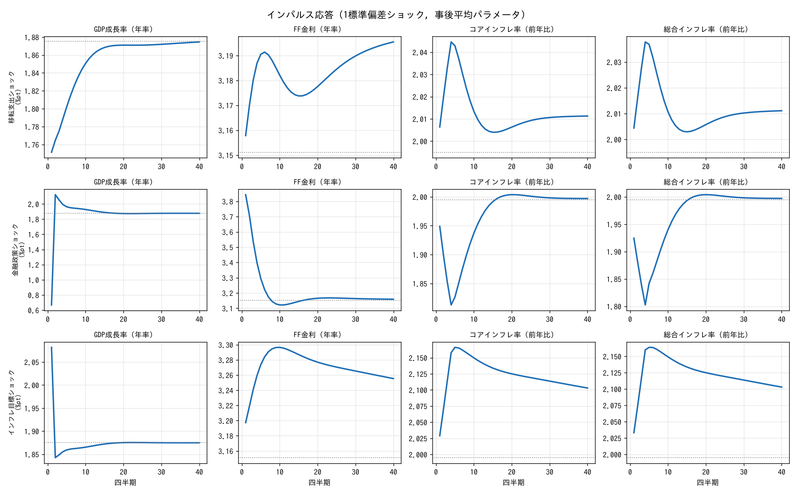
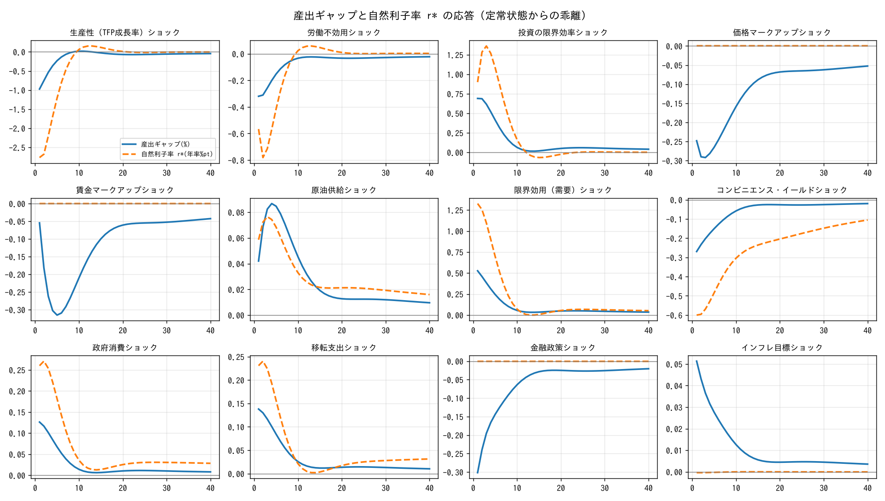

# セントルイス連銀の最新DSGEモデルをPythonで動かしてみた（インパルス応答の再現まで）

> note 下書き。図は `figures/` の PNG を note にアップロードして差し替えてください。

## はじめに

2026年11月、セントルイス連銀（FRB St. Louis）の *Review* に、同連銀の調査部が予測と政策分析のために使っている DSGE モデルの解説論文が掲載されました。

- 論文：Miguel Faria-e-Castro, "The St. Louis Fed DSGE Model", *Federal Reserve Bank of St. Louis Review*, Fourth Quarter 2026, Vol. 108, No. 14, pp. 1-38
- 記事ページ：[https://www.stlouisfed.org/publications/review/2026/nov/st-louis-fed-dsge-model](https://www.stlouisfed.org/publications/review/2026/nov/st-louis-fed-dsge-model)
- DOI：[https://doi.org/10.20955/r.2026.14](https://doi.org/10.20955/r.2026.14)

オリジナルの推計は Dynare（MATLAB）で行われていますが、コードは公開されていないようです。そこで、論文の付録に載っている均衡条件をそのまま Python に書き起こし、**付録Dのインパルス応答（IRF）がどこまで再現できるか**を試しました。

コードはこちらで公開しています：[https://github.com/p72/stlouis-dsge-python](https://github.com/p72/stlouis-dsge-python)

## このモデルの3つの特徴

ベースは Smets-Wouters 型の中規模ニューケインジアンモデルですが、ほかの連銀モデルにはない拡張が3つあります。

### 1. 家計の異質性：「労働者」と「資本家」
Cantore and Freund (2021) にならい、家計を2種類に分けています。

| | 資本家（約39%） | 労働者（約61%） |
|---|---|---|
| 働くか | 働かない | 働く（労働組合が賃金を設定） |
| 資産 | 国債・資本・企業を保有 | 国債のみ（ポートフォリオ調整費用あり） |
| 限界消費性向 | 低い（リカーディアン） | 高い。ただし1ではない |

完全な hand-to-mouth にせず「調整費用つきで貯蓄できる」ようにしているのがポイントです。おかげで、給付金のような移転支出の効果を分析しても、MPC=1 のような極端な結果になりません。

### 2. 本格的な財政ブロック
政府消費、移転支出、消費税、労働所得税、資本所得税、国債をすべて明示的に扱います。税率は債務/GDP比に反応する財政ルールに従うので、「財政赤字 → 債務増 → 将来の増税」という経路が入っています。

### 3. 原油
原油は**生産の投入物**であり、**消費財**でもあります（Gagliardone and Gertler, 2023）。どちらも他の財と強い補完関係にあります。そのため、原油価格ショックが総合インフレだけでなくコアインフレにも波及し、**コアと総合のインフレの違い**を描けます。

このほか、12個の構造ショック（TFP、労働供給、投資効率、価格・賃金マークアップ、原油供給、需要、コンビニエンス・イールド、政府消費、移転支出、金融政策、インフレ目標）があります。推計は1959Q1〜2026Q2の15系列を使ったベイズ推定で、COVID期には特殊ショックを入れています。

## Python移植でやったこと

| 工程 | 中身 |
|---|---|
| 均衡条件 | 付録Aの式 (47)〜(99) をトレンド除去後の形でそのまま実装 |
| 伸縮価格経済 | 同時に解いて、産出ギャップと自然利子率 r* を計算 |
| 定常状態 | 解析的に計算（労働=1、原油の実質価格=1 に正規化） |
| 線形化 | 複素ステップ微分で機械精度のヤコビアンを計算 |
| 解法 | `scipy.linalg.ordqz`（QZ分解）による Blanchard-Kahn / Klein 型の一次近似解 |
| パラメータ | 表1のカリブレーション値と、表C-1・C-2の事後平均 |

変数は全部で98個です。Blanchard-Kahn 条件（安定根の数 = 98）を満たし、行列方程式の残差は 5e-12 でした。

使い方はとても簡単です。

```bash
pip install -r requirements.txt
python stlouis_dsge.py   # figures/ にIRFの図が保存される
```

```python
from stlouis_dsge import Model
m = Model().solve()
irf = m.irf('mp', T=40)                 # 金融政策ショックへの1標準偏差の応答
ffr = m.series(irf, 'ffr')              # FF金利（年率%）の経路
```

## 結果：12個中10個のショックでIRFがほぼ一致

論文の付録Dと同じく、GDP成長率、FF金利、コアインフレ（前年比）、総合インフレ（前年比）の4変数を描きました。



論文の図から目で読み取った値と比べると、次のようになりました。

| ショック | FF金利の極値 論文 / Python | コアインフレの極値 論文 / Python |
|---|---|---|
| インフレ目標 | 3.28 / 3.30 | 2.165 / 2.17 |
| 需要（限界効用） | 3.45 / 3.47 | 2.17 / 2.18 |
| コンビニエンス・イールド | 2.75 / 2.69 | 1.73 / 1.73 |
| 原油供給 | 3.18 / 3.19 | 総合 1.84 / 1.85 |
| 価格マークアップ | 3.33 / 3.40 | 2.17 / 2.21 |
| 金融政策 | 3.70 / 3.84 | 1.76 / 1.81 |

公開された式とパラメータだけから、形も大きさもかなり再現できました。

伸縮価格経済も同時に解いているので、産出ギャップと自然利子率 r* の応答も出せます。



## まだ合っていないところ

- **TFP成長率ショックと労働不効用ショック**（どちらも恒久的なトレンドを動かすショック）は、インパクト時のGDP成長率が論文より小さく（TFPでは論文4.0に対してPython 2.5）、FF金利の低下は大きく出ます。論文に書かれていない実装の細部（賃金フィリップス曲線のトレンド調整や、Dynare での変数のタイミングなど）が原因だと考えていますが、原典のコードがないので確かめられていません。
- **ベイズ推定**（15個の観測変数、カルマンフィルタ、MCMC）はまだです。いまは論文の事後平均をそのまま使っています。

## 今後やりたいこと

1. **歴史分解の再現**：論文の図4にある「コアPCEインフレ（前年比）の歴史分解」です。2021〜23年のインフレを供給、需要、金融、財政、原油に分けたもので、論文では財政（移転支出）と金融政策の寄与が大きいと出ています。Python で作るには、FRED などから観測データ15系列を集めて観測方程式を実装し、カルマン平滑化で構造ショックを取り出す必要があります。次の大きな目標です。
2. 10年金利、10年インフレ期待、コンビニエンス・イールドの観測方程式の実装
3. 事後モードの推定とMCMC
4. 原油先物やFF金利先物を条件にした条件付き予測

## おわりに

中央銀行の本格的なDSGEモデルでも、論文の付録がしっかりしていれば、numpy/scipy だけで数百行で動かせます。とくに財政ブロックとTANK構造が入っているので、「給付金はインフレにどれだけ効くのか」といった問いを手元で試せるのが面白いところです。続きは歴史分解編で書く予定です。

---
参考文献
- Faria-e-Castro, M. (2026) "The St. Louis Fed DSGE Model," FRB St. Louis *Review*, 108(14). [https://doi.org/10.20955/r.2026.14](https://doi.org/10.20955/r.2026.14)
- Cantore, C. and L. B. Freund (2021) "Workers, capitalists, and the government: fiscal policy and income (re)distribution," *Journal of Monetary Economics*, 119, 58–74.
- Gagliardone, L. and M. Gertler (2023) "Oil Prices, Monetary Policy and Inflation Surges," NBER WP 31263.
- Smets, F. and R. Wouters (2007) "Shocks and Frictions in US Business Cycles," *American Economic Review*, 97(3), 586–606.
